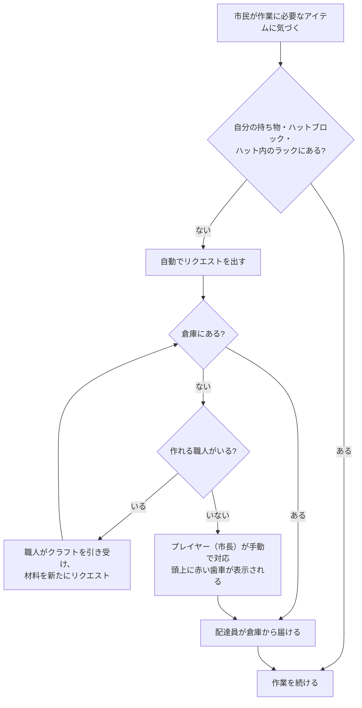
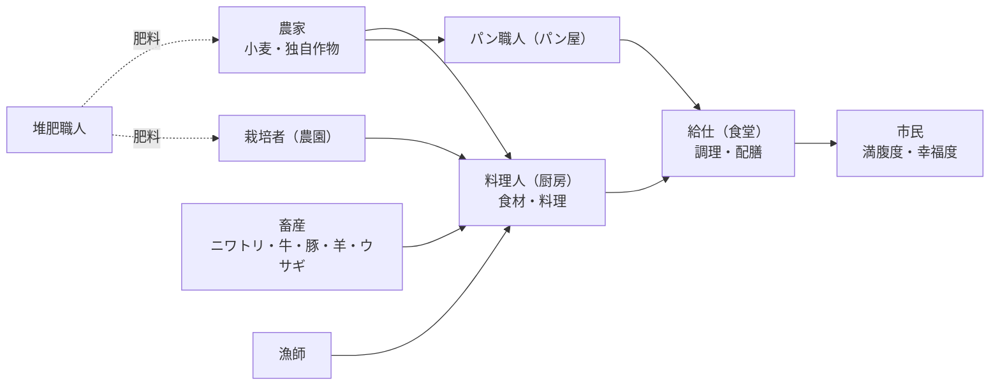
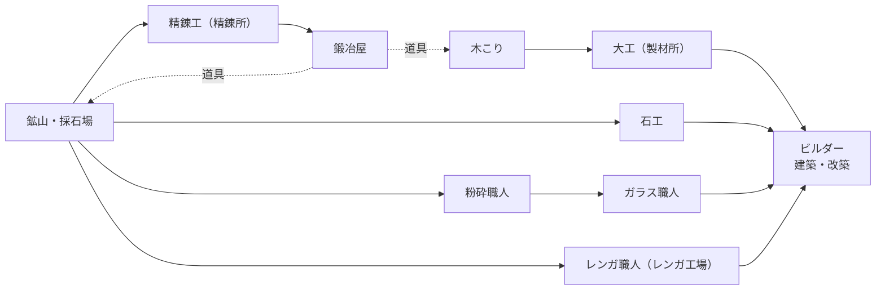

<!-- 確認用：GitHub Wiki の全ページを1ファイルにまとめたもの。Wikiへはzip内の個別ファイルを使ってください。 -->


<!-- ===== ページ: Home.md ===== -->

# MineColonies 調査Wiki

卒業研究「Minecraftを用いた社会シミュレーション」で使用する MOD **MineColonies** について、**何ができるか・何を表現できるか**を研究室内で共有するためのまとめです。

## 研究の進め方と、このWikiの位置づけ

| ステップ | 内容 | このWikiとの関係 |
| --- | --- | --- |
| 1. 社会課題の設定 | 実社会から扱う社会課題を選ぶ | MineColoniesで表現できる要素を把握したうえで選ぶ |
| 2. 評価指標の設計 | 既存の指標があれば利用、なければ設計・実装 | MineColonies内で観測できる値（幸福度・統計など）を把握しておく |
| 3. 実装 | MineColonies上で設定どおりに動かす | 設定ファイル・データパック・コマンドなどの操作手段を把握しておく |

このWikiはステップ1の前段として、MineColoniesの機能を整理したものです。

## ページ一覧

| ページ | 内容 |
| --- | --- |
| [MineColonies 概要](MineColonies-概要) | MODの概要、対応バージョン、前提MOD、コロニー開始の流れ、時間の進み方 |
| [市民とニーズ](MineColonies-市民とニーズ) | 市民のスキル、幸福度（計算式つき）、食事、睡眠・住居、出生、病気、死亡 |
| [建物一覧](MineColonies-建物一覧) | 全51建物の役割とレベルによる変化 |
| [職業一覧](MineColonies-職業一覧) | 全45職業と主スキル・副スキル |
| [経済と物流](MineColonies-経済と物流) | リクエストシステム、倉庫と配達員、クラフトの連鎖、食料の生産チェーン |
| [研究システム](MineColonies-研究システム) | 大学での研究ツリー（市民・戦闘・技術） |
| [防衛と外交](MineColonies-防衛と外交) | 衛兵、襲撃、領土、保護、コロニー間の接続・同盟 |
| [クエストとアイテム](MineColonies-クエストとアイテム) | クエスト、訪問者、主要アイテム・ツール |
| [カスタマイズと観測](MineColonies-カスタマイズと観測) | 設定ファイル、コマンド、データパック、スケマティック、統計の取り方 |
| [社会シミュレーションへの対応](MineColonies-社会シミュレーションへの対応) | MineColoniesの仕組みと社会課題・評価指標の対応候補（たたき台） |

## 調査の前提

- **調査日**: 2026-09-25
- **主な情報源**: MineColonies公式Wiki（<https://minecolonies.com/wiki>）と、そのソースリポジトリ [ldtteam/MinecoloniesWiki](https://github.com/ldtteam/MinecoloniesWiki)（2026-09-18 時点）
- **補足の情報源**: 公式Wikiに書かれていない数値や仕組みは、MOD本体のソースコード [ldtteam/minecolonies](https://github.com/ldtteam/minecolonies) の `version/main` ブランチ（Minecraft 1.20.1 向け、2026-09-23 時点）で確認しました。
- **日本語名**: 建物名・職業名の日本語はこのWiki独自の訳です。ゲーム内の日本語表記とは違う場合があるので、英語名を併記しています。

## 表記ルール

| 表記 | 意味 |
| --- | --- |
| （なし） | 公式Wikiの記載に基づく内容 |
| 【ソース確認】 | 公式Wikiに記載がなく、MOD本体のソースコードで確認した内容。MODの更新で変わる可能性がある |
| 【要検証】 | 推測を含む、またはゲーム内で未検証の内容 |

---

<!-- ===== ページ: MineColonies-概要.md ===== -->

# MineColonies 概要

## MineColoniesとは

- LDTTeam（Let's Dev Together Team）が開発している Minecraft 用の町づくりMOD。ソースコードは GitHub で GPL-3.0 として公開されている。
- プレイヤーは**市長（mayor）**としてコロニー（町）を作る。NPCの**市民（citizen / colonist）**が、建築・農業・漁業・採掘・製造・輸送・防衛などの仕事を自分で判断して進める。
- 建物は**スケマティック（設計図）**として用意されている。プレイヤーが場所を決めると、**ビルダー（建築家）**が必要な資材を要求しながら自動で建てる。
- ほとんどの建物は**レベル1〜5**に改築でき、レベルが上がるほど雇える人数・扱えるレシピ数・効果範囲などが増える（一部の建物は最大レベル3）。
- 市民には**スキル・幸福度・満腹度・住居・職場・病気**などの状態がある。出生・病気・死亡・喪など、社会的な出来事も起こる。

## 対応バージョン（2026年9月時点）

| Minecraft | MODローダー | MOD本体のブランチ | 備考 |
| --- | --- | --- | --- |
| 1.20.1 | Forge | `version/main` | 2026-09 時点でも更新が続いている |
| 1.21.1 | NeoForge | `version/1.21` | CurseForgeで `minecolonies-1.1.xxxx-1.21.1.jar` として配布されている |

- 公式Wikiは 1.18〜1.21.1 を対象にしていて、ページ内にバージョンごとの記述の違いがある。
- 1.20.1版と1.21.1版のどちらにも、ゲートハウス・厩舎・コロニー間接続・データパックで定義する病気などの新しめの機能が入っている【ソース確認】。
- 1.20以降は一部の建物名・職業名が変わっている（例: Restaurant → Dining Hall、Cook → Waiter、Stone Smeltery → Brick Yard）。このWikiでは1.20以降の名前を使う。
- **研究室で使うMinecraft/MODのバージョンを統一しておく必要がある（要決定）。**

## 前提MOD

MineColoniesを動かすには次のMODも必要。

| MOD | 役割 |
| --- | --- |
| Structurize | スケマティック（設計図）の建築処理。ビルドツール・スキャンツール・シェイプツールなどを提供する |
| Domum Ornamentum | 装飾ブロックを組み合わせてクラフトする仕組み |
| BlockUI | XMLベースのGUIライブラリ |
| Multi-Piston | 複数のブロックをまとめて動かせるピストン |

## 基本用語

| 用語 | 意味 |
| --- | --- |
| コロニー（Colony） | プレイヤーが作る町。町役場を中心とした領土（チャンク単位）を持つ |
| 市民（Citizen / Colonist） | コロニーに住むNPC。大人は職業に就き、子どもは成長する |
| 市長（Mayor） | コロニーの所有者（プレイヤー） |
| ハット（Hut） | 職業ごとの作業小屋。ハットブロックを置き、その周りに建物を建てる |
| ハットブロック | 建物の機能を持つブロック。右クリックでGUIを開き、雇用・設定・改築を行う |
| ワークオーダー（Work Order） | 建築・改築・修理・移設などの作業指示。町役場で優先順位を変えられる |
| スケマティック / スタイル | 建物の設計図とその見た目のセット（中世風・和風など複数のスタイルパックがある） |

## コロニー開始の流れ（公式「Getting Started」の要約）

1. **コロニーを作る**
   - 方法A: **補給キャンプ（Supply Camp）/ 補給船（Supply Ship）**を設置する（1ワールドにつき1回）。町役場ブロックとビルドツール、初期資材が手に入る。
   - 方法B: ワールド生成で出てくる**放棄されたコロニー**を見つけ、町役場から新しいコロニーとして作り直す。各ハットブロックで「Reactivate」すると建物を取り戻せる。
2. **町役場（Town Hall）を設置して創設する**。初期市民は4人（設定で変更可）。町役場ブロックの位置を中心に、初期設定では半径4チャンクが領土・保護範囲になる。この中心はあとから変えられない。
3. **ビルダーの小屋（Builder's Hut）**を最初に建てる。ビルダーは自分の小屋のレベルまでしか、ほかの建物を建築・改築できない。
4. **住居**: 酒場（Tavern）や住宅（Residence）を建てる。
5. **食料**: 漁師の小屋がいちばん早く食料を確保できる。農家や畜産、食堂（Dining Hall）も用意する。
6. **木こりの小屋（Forester's Hut）**と**鉱山（Mine）**で木材・石材・鉱石を確保する。
7. **倉庫（Warehouse）**と**配達員の小屋（Courier's Hut）**で物流を自動化する。
8. その後は、衛兵塔（襲撃への備え）、病院（病気）、製材所（クラフト）などを増やしていく。

## コロニーの時間の進み方

- 市民は日中に働き、夜は家に帰って寝る。
- 公式Wikiでは「**雨・雪・夜のあいだと、前日に市民が死亡した日は仕事を休む**」とされている。
  - 【ソース確認】実際には、衛兵は雨でも働く。喪で休むのは亡くなった市民の家族・同居人だけ（翌日）。研究 Rainman を完了するか、設定 `workersalwaysworkinrain` を有効にすると、雨でも働く。
- 研究「Night Owl」「Night Owl II」で1日の労働時間が +1時間 / +2時間 になる【ソース確認】。
- 昼夜サイクルを止めると、襲撃・農家・病気・子どもの成長などの挙動が予測できなくなる、と公式Wikiに書かれている。
- **コロニーが動作する条件**: オーナーまたはオフィサーがコロニー内のチャンクを読み込むと、設定 `forceloadcolony`（初期値 true）によってコロニーのチャンクが読み込まれたまま維持される。プレイヤーが離れたあとも読み込みが続く時間は設定 `loadtime`（初期値 20分）で決まる。オーナー／オフィサーが誰もログインしていないと、この時間は3倍の速さで減る【ソース確認】。
- **実験上の注意**: シミュレーションを無人で長時間回す場合は、プレイヤー（オーナー）がいないとコロニーが止まる・襲撃が起こらないなどの条件を事前に確認しておく必要がある（襲撃は、オーナーやオフィサーなど権限を持つプレイヤーがサーバーにログインしていることが発生条件の一つ【ソース確認】）。

## 参考リンク

- 公式Wiki: <https://minecolonies.com/wiki>
- Getting Started: <https://minecolonies.com/wiki/tutorials/getting-started>
- 前提MOD: <https://minecolonies.com/wiki/dependencies/structurize> ほか

---

<!-- ===== ページ: MineColonies-市民とニーズ.md ===== -->

# 市民とニーズ

MineColoniesの市民は、スキル・幸福度・満腹度・住居・職場・健康状態などを持つNPCです。このページでは、市民の状態と、それを左右するニーズ（食事・睡眠・住居・安全・医療など）をまとめます。

## 1. 市民が持つ状態

| 状態 | 内容 |
| --- | --- |
| 基本情報 | 名前、性別、大人／子ども、体力（HP） |
| スキル | 11種類。職業ごとに主スキル・副スキルが決まっている |
| 満腹度（Saturation） | プレイヤーの空腹ゲージに近い。働くと減り、食堂で食事をとると回復する |
| 幸福度（Happiness） | 0〜10。複数の要因の加重平均で決まる（後述） |
| 住居 | 割り当てられたベッド（住宅・酒場・兵舎など） |
| 職場 | 雇われているハット。無職の場合もある |
| 健康 | 病気・けがの有無 |

市民のGUIや町役場の「Citizens」タブで、体力・幸福度・満腹度などを確認できます。

## 2. スキルと成長

**11種類のスキル**: Athletics（運動）、Dexterity（器用さ）、Strength（筋力）、Agility（敏捷性）、Stamina（持久力）、Mana（魔力）、Adaptability（適応力）、Focus（集中力）、Creativity（創造性）、Knowledge（知識）、Intelligence（知性）

- 職業ごとに**主スキル**（雇用画面で緑表示）と**副スキル**（黄表示）があり、値が高いほど作業が速く効率的になる。スキルごとに職業特有のボーナスもある（[職業一覧](MineColonies-職業一覧)を参照）。
- 市民は働くことでスキルが上がる。上がる速さは、**職場のレベル**と**Intelligence**で決まる。
- **Intelligence** はほかのスキルの上がりやすさに影響する。大人は図書館、子どもは学校で上げられる。
- スキルの上限は**住居のレベル**で決まる。

| 住居レベル | スキル上限 |
| --- | --- |
| 0 | 10 |
| 1 | 20 |
| 2 | 30 |
| 3 | 40 |
| 4 | 50 |
| 5 | 99 |

## 3. 幸福度

### 3.1 公式Wikiでの説明

- 幸福度には**コロニー全体の幸福度**と**市民個人の幸福度**がある。
  - コロニー全体の幸福度が高いと、新しく来る市民の初期レベル・スキルが高くなる。
  - 個人の幸福度が高いと、図書館で到達できるIntelligenceの上限が上がる。
- 全体の幸福度は主に**安全・住居・満腹度**の3つで決まる。
  - 満腹度が十分に高い
  - 住居（衛兵や訓練生は職場）のレベルが 2.5 より上
  - 市民3人につき衛兵が2人以上いる
  - どれも部分的に満たすだけでも効果があり、さらに上回るとより幸福になる（例: 住宅をレベル4・5にする、満腹度を満タンにする）。
- **幸福度が下がる出来事**
  - 衛兵以外の市民が死ぬと、ほかの市民は翌日に喪に服し、その後3日間幸福度が下がる。
  - けがをすると、翌日に少しだけ下がる。
  - **病気・ホームレス・無職・職場でやることがない**状態だと毎晩下がり、長く続くほど悪化する。
  - 衛兵以外の市民が夜にベッドまで行けないと下がる。
  - ほかの市民の暮らしぶりも影響する（町役場の幸福度画面の「Social」要因）。
- **幸福度が上がる出来事**
  - 市民を一人も失わずに襲撃を乗り切ると、コロニー全体の幸福度にボーナス。
  - 家や職場の近くに衛兵塔があると安心する。
  - 神秘の祭壇（Mystical Site）があると上がる（最も高いレベルの1つだけが効く）。

### 3.2 幸福度の計算式【ソース確認】

各市民の幸福度は、次の**10個の要因**の加重平均で計算されます（`CitizenHappinessHandler.java`）。

```
幸福度 = min( 10,  10 × ( Σ 係数_i × 重み_i ) / ( Σ 重み_i ) × (1 + 研究ボーナス) )
```

- 係数は **1.0 が中立**、1.0 未満はマイナス、1.0 より大きいとプラス。
- **係数がちょうど 1.0 の要因は、分子・分母の両方から除外される**。つまり、中立でない要因だけで平均をとる。
- 研究ボーナスは市民ツリーの研究（Circus〜Theater）で +5%〜+50%。

| 要因 | 重み | 係数の決まり方 |
| --- | --- | --- |
| 安全（Security） | 4.0 | `(衛兵数+1) / ((衛兵以外の人数+1) × 2/3)`、上限2。衛兵：その他 = 2：3 で 1.0 |
| 食事（Food） | 3.0 | **多様性** = min(5, 直近10食の種類数 ÷ 住居レベル) と **質** = min(5, 直近10食のうちMineColoniesの料理の数 ÷ max(1, 住居レベル−2)) の平均。住居がない、または食事履歴がまだ埋まっていない場合は 1.0 |
| 住居（Homelessness） | 3.0 | 住居なし 0、住居あり `住居レベル / 3`（レベル3で中立、レベル5で約1.67）。係数が1未満の状態（住居なし、またはレベル1〜2の住居）が7日続くと ×0.75、14日続くと ×0.5 |
| 社会（Social） | 2.0 | `(総人口 − 無職 − ホームレス − 病人 − 空腹者) / 総人口`。**コロニー全体の暮らしぶり**を表す |
| 雇用（Unemployment） | 2.0 | 無職 0.5、職場レベル4以上 2.0、それ以外 1.0（子どもは 1.0）。無職が7日続くと ×0.75、14日で ×0.5 |
| 健康（Health） | 2.0 | 病気 0.5、健康 1.0。病気が7日続くと ×0.5、14日で ×0.1 |
| 睡眠（Slept tonight） | 1.5 | 衛兵は 1.0。それ以外は、眠れた日は 1.0、2日眠れないと 0.8、3日以上で 0.5 |
| 学校（School） | 1.0 | 子ども: 学校に通っていれば 2.0、通っていなければ 0。大人は 1.0 |
| 神秘の祭壇（Mystical Site） | 1.0 | `max(1, 祭壇の最高レベル / 2)`。マイナスにはならない（最大 2.5） |
| 職場で暇（Idle at job） | 1.0 | 職場でやることがない 0.5、それ以外 1.0。7日続くと ×0.5、14日で ×0.1 |

> 社会シミュレーションの観点では、この幸福度は「安全・食・住・雇用・健康・教育」をまとめた**既存の合成指標**として使える可能性があります。詳しくは [社会シミュレーションへの対応](MineColonies-社会シミュレーションへの対応) を参照。

## 4. 食事と満腹度

### 4.1 基本

- 食料の流れ: 農家などが作物を育てる → **料理人（Chef）**が厨房（Chef's Kitchen）で料理を作る → **給仕（Waiter）**が食堂（Dining Hall）で調理・配膳する。パン屋（Baker）もパンや菓子を作る。
- 市民は満腹度が下がると食堂に行く。食堂がない場合は、食堂を要求するか、プレイヤーに食料を直接求める。
- 満腹度は働くと減り、寝るときにも減る。**レベルの高い労働者ほど夜の減り方が大きい**。
- 満腹度が高いと、回復が速くなり、レベルも上がりやすくなる。満腹だと回復速度が2倍になる。
- **満腹度が0になると、仕事をやめ、レベルが上がらなくなり、鈍化状態になり、チャットで食べ物を求め続ける**。一定以下では回復もしなくなる。
- 食料消費量は設定 `foodmodifier`（初期値 1.0）で調整できる【ソース確認】。

### 4.2 料理のランクと住居レベル

- バニラ（Minecraft標準）の食べ物も食べられるが、ペナルティがあり（幸福度が下がり、栄養も少ない）、MineColoniesの料理のほうがよい。
- MineColoniesの料理は**ランク（Tier）1〜3**に分かれていて、GUIでは銅・銀・金の背景色で表示される。
- **住居レベルが上がるほど、市民が求める料理のレベルが上がる。基準を満たさない料理は食べない。**
  - 【ソース確認】住居レベル3以上では、栄養値（nutrition）が「住居レベル+1」以上の食べ物しか食べない。直近10食について、多様性（種類数）は「住居レベル」種類以上、質（MineColoniesの料理の数。ランクは問わない）は「住居レベル−2」個以上が求められる。

### 4.3 作物とバイオーム

MineColonies独自の作物は、**農家だけが育てられる**（プレイヤーは育てられない）。作物ごとに育つバイオームの区分（寒冷・温暖・湿潤・乾燥）が決まっているので、**コロニーの場所で手に入る作物が変わる**。上位の料理には複数のバイオームの材料が必要なものがあり、**ほかのコロニーとの取引が必要になる**。

【ソース確認】独自作物（15種）とバイオーム区分:

| 区分 | 作物 |
| --- | --- |
| 寒冷（cold） | キャベツ（Cabbage）、バターナッツカボチャ（Butternut Squash） |
| 温暖（temperate） | ピーマン（Bell Pepper）、トマト（Tomato）、トウモロコシ（Corn） |
| 湿潤（humid） | 大豆（Soybean）、米（Rice、水を張った農地）、エンドウ豆（Peas） |
| 乾燥（dry） | ひよこ豆（Chickpea）、ネザーペッパー（Nether Pepper） |
| 区分なし | デュラム小麦（Durum）、ナス（Eggplant）、ニンニク（Garlic）、タマネギ（Onion）、ミント（Mint） |

> 公式Wikiでは「作物はそれぞれ決まったバイオームでのみ育つ」とあるが、ソースコード上はバイオームの指定がない作物もある【要検証】。

## 5. 睡眠と住居

- 市民は毎日、日没から翌日の日の出まで、家に帰ってベッドで寝る。眠れると幸福度が上がり、**3日以上ベッドにたどり着けないと不満を言う**。
- ベッドは**住宅（Residence）**と**酒場（Tavern）**が主に提供する。町役場で設定すれば、市民をベッドに手動で割り当てられる（設定しなければ空いているベッドにランダムに割り当てられる）。
  - 住宅: いくつでも建てられる。**レベル1つにつきベッド1つ**（レベル5で5人）。住宅のレベルはスキル上限にも影響する。
  - 酒場: コロニーに1つだけ（初期設定）。ベッドは4つで、改築しても増えない。最大レベル3。
  - 衛兵塔はベッド1つ、兵舎は多数の衛兵を住まわせる。
- **通勤距離**: 職場から100ブロック以上離れた家に住むと「職場から遠すぎる」と不満を言う。ほかの市民とベッドを交換すると解決する。
- **ホームレス**: 家のない市民は夜に町役場に集まる。家がないまま**2週間**たつと不満を持つ（【ソース確認】7日で不平、14日で要求）。家は襲撃時の避難場所にもなる。

## 6. 人口の増え方

- 初期市民は4人（設定 `initialcitizenamount`、1〜10）。
- 初期の4人分の住居を用意したあとは、次の2つの方法で人口が増える。
  1. **空きベッドを用意する**と新しい市民がやってくる。
  2. **酒場の訪問者**に、要求されたアイテムを渡して勧誘する。酒場のレベルが上がると、訪問者の数と質が上がる。
- **出生**: コロニーに男性と女性が少なくとも1人ずついれば、子どもが生まれることがある。子どもはベッドを1つ使うが、親と同じ家である必要はない。**子どもの親は、生まれた建物に住んでいる大人**（性別を問わず2人、1人、または0人）になる。子どもは親のスキルを一部受け継ぐため、**スキルの高い親が幸福度の高いコロニーにいると、子どもの初期能力も高い**。
- **人口の上限** = min(ベッド数, 研究による上限, 設定の上限)【ソース確認】
  - 研究なしの上限は **25人**。市民ツリーの研究 Outpost → Hamlet → Village → City で 50 → 100 → 150 → 500 に上がる。
  - 設定 `maxcitizenpercolony` の初期値は **250**（25〜500）。
- 町役場の設定で、新しい市民の出現（子どもを含む）をオフにできる。

## 7. 子どもと教育

- 子どもは成長して大人になり、仕事に就く。研究（Nurture〜Beanstalk）で成長速度が上がる。
- **学校（School）**: **教師（Teacher）**が**生徒（Pupil、子ども）**のIntelligenceを上げる。紙があると早く上がる。教えられる人数は学校レベル×2（レベル5で10人）。
- **図書館（Library）**: 大人が「図書館の学生」として勉強し、Intelligenceを上げる。フルタイムの仕事扱いなので、ほかの職業とは兼任できない。人数はレベル×2。紙と本で上がりやすくなる。
- 【ソース確認】学校に通っていない子どもは、幸福度の「学校」要因が 0 になる（通っていれば 2.0）。

## 8. 病気と医療

### 8.1 公式Wikiでの説明

- 市民は病気になり、**病院（Hospital）**で**医師（Doctor）**に治療してもらう。病気はコロニー内に広がることがある。
- 初期設定の病気と、治療に必要なアイテム:

| 病気 | 治療に必要なアイテム |
| --- | --- |
| インフルエンザ（Influenza） | ニンジン、ジャガイモ |
| 麻疹（Measles） | タンポポ、昆布、ポピー |
| 天然痘（Smallpox） | ハチミツ入りの瓶、金のリンゴ |

- 病院のベッド数（同時に治療できる人数）= 病院レベル（レベル5で5人）。
- 病気の種類は、1.20以降は**データパック**で変更できる（1.19.4以前は設定ファイル）。

### 8.2 発症と感染のしくみ【ソース確認】

`CitizenDiseaseHandler.java` と病気データの確認結果:

- **自然発症**: 一定間隔の判定ごとに、小さな確率で発症する。確率は次で変わる。
  - 設定 `diseasemodifier`（初期値5。1 = 非常に多い、100 = 非常にまれ）
  - 職業ごとの係数（初期値1.0）
  - **食事の多様性**: 食事履歴が埋まっていると、係数 × 0.5 × min(2.5, 5 / 多様性)。**いろいろな料理を食べている市民ほど病気になりにくい**（多様性5で0.5倍、2以下で1.25倍）。
- **接触感染**: 病気の市民とぶつかる（衝突する）と、**1%の確率**で同じ病気がうつる。
  - 研究 **Masks（マスク）** を完了すると、うつるはずだった感染のうち半分を防ぎ、短い免疫がつく。
- **発症しない条件**: 医師は病気にならない。コロニーの人口が初期市民数（初期値4）以下のあいだは病気にならない。
- **どの病気になるか**: 病気データの `rarity` を重みとして選ばれる（初期値: インフルエンザ 100、麻疹 10、天然痘 1）。
- **治療後の免疫**: 病院のベッドで治療されると **108,000 tick（現実の約90分、ゲーム内の約4.5日）**免疫がつく。研究 **Vaccines（ワクチン）** を完了すると10倍になる。ベッド以外で治った場合は半分。
- **けが**: 体力が6未満になった（衛兵以外の）市民は、満腹度が足りていれば医師のところへ行く。
- 治療の回数は統計 `citizens_healed` として記録される。

## 9. 死亡・喪・墓地

- 市民は魔物や襲撃で死ぬことがある。**衛兵以外の市民が死ぬと、家族は喪に服してその日は働かず、翌日以降も幸福度が下がる**。衛兵の死は悼まれない。
  - 【ソース確認】喪に服すのは、亡くなった市民の家族（パートナー・親子・兄弟姉妹）と同居人で、翌朝から。衛兵と墓守は喪に服さない。
- **墓地（Graveyard）**: **墓守（Undertaker）**が遺体を墓地に運び、蘇生を試みる。失敗すると名前入りの墓に埋葬する。
  - 蘇生の確率は、研究（+1%, +2%）、墓守のMana（1ポイントにつき+0.125%）、墓地のレベル（1レベルにつき+0.5%）、トーテム（研究で解放）で上がる。
  - 上限は初期値2.5%で、神秘の祭壇（1レベルにつき+0.5%）とトーテムで上がり、最大12.5%。
  - 墓守は喪に服さない。

## 10. 装備

- 労働者が使える道具・武器・防具は、**職場（ハット）のレベル**で制限される。
  - 例: 石の道具はレベル1以上、鉄はレベル2以上、ダイヤモンドはレベル3以上、ネザライトはレベル4以上。エンチャントのレベルにも制限がある。
- 衛兵の防具も、塔のレベルで使える素材（革・金 → チェーン → 鉄 → ダイヤモンド → ネザライト）が決まる。
- 道具は鍛冶屋（Blacksmith）、弓・矢・釣り竿は矢師（Fletcher）が作る。

## 参考リンク

- 幸福度: <https://minecolonies.com/wiki/needs/happiness>
- 食事: <https://minecolonies.com/wiki/needs/food>
- 睡眠: <https://minecolonies.com/wiki/needs/sleep>
- 装備: <https://minecolonies.com/wiki/needs/gear>
- スキル: <https://minecolonies.com/wiki/systems/traits>
- 病院: <https://minecolonies.com/wiki/buildings/hospital>
- 墓地: <https://minecolonies.com/wiki/buildings/graveyard>
- ソース: [CitizenHappinessHandler.java](https://github.com/ldtteam/minecolonies/blob/version/main/src/main/java/com/minecolonies/core/entity/citizen/citizenhandlers/CitizenHappinessHandler.java), [CitizenDiseaseHandler.java](https://github.com/ldtteam/minecolonies/blob/version/main/src/main/java/com/minecolonies/core/entity/citizen/citizenhandlers/CitizenDiseaseHandler.java), [ModHappinessFactorTypeInitializer.java](https://github.com/ldtteam/minecolonies/blob/version/main/src/main/java/com/minecolonies/apiimp/initializer/ModHappinessFactorTypeInitializer.java)

---

<!-- ===== ページ: MineColonies-建物一覧.md ===== -->

# 建物一覧

公式Wikiに掲載されている**51種類の建物**を、役割ごとに10のカテゴリに分けてまとめます。

- 英語名は1.20以降の名前です（括弧内は旧名）。日本語名はこのWiki独自の訳です。
- 特に書いていない限り、建物の最大レベルは5です。
- 建物はビルダーが建てます。ビルダーは**自分の小屋のレベルまで**しか建築・改築できません。
- どの建物も、建てると周囲のチャンクを領土として確保します（詳しくは [防衛と外交](MineColonies-防衛と外交)）。

## 共通の仕組み

- **ハットブロック**を右クリックすると建物のGUIが開き、建築・改築・修理・移設の指示、労働者の雇用（自動／手動）、在庫の確認などができる。
- クラフト系の建物は、教えられるレシピの数がレベルで増える（多くは レベル1: 10、2: 20、3: 40、4: 80、5: 160）。
- 多くの建物には**統計**タブがあり、その建物での作業量（例: 収穫した作物の数）を確認できる。
- 病院・学校・図書館・墓地・神秘の祭壇、製造系の多く、兵舎・戦闘アカデミー・弓術場・厩舎などは、**大学での研究を完了しないと建てられない**【ソース確認】。一覧は [研究システム](MineColonies-研究システム) を参照。

## 1. 行政・建設・物流（4）

| 建物（英語名） | 仮訳 | 職業 | 主な機能 | レベル・備考 |
| --- | --- | --- | --- | --- |
| Town Hall | 町役場 | なし | コロニーの中心。名前・旗の設定、町の地図、傭兵の雇用、イベントログ、ワークオーダーの管理、権限、市民一覧と幸福度、統計、同盟、雇用・住居の自動割り当て設定 | 1つだけ。領土の半径がレベルで広がる。同盟コロニーへのテレポートはレベル3以上 |
| Builder's Hut | ビルダーの小屋 | ビルダー | 建物・装飾・自作スケマティックの建築、改築、修理、解体 | 最初に建てる建物。複数建てられる。研究で建築パターンを選べる |
| Warehouse | 倉庫 | 配達員 | コロニー全体の中央倉庫（ラックに保管） | 配達員はレベル×2人（最大10人）。レベル3で整理機能、レベル5でエメラルドブロックを使って容量を拡張（3回まで） |
| Courier's Hut | 配達員の小屋 | 配達員 | 倉庫と各建物のあいだで物を運ぶ配達員の住まい | 1つの小屋に配達員1人。一度に運べるスタック数: 2 / 3 / 4 / 5 / 無制限 |

## 2. 住居（2）

| 建物（英語名） | 仮訳 | 職業 | 主な機能 | レベル・備考 |
| --- | --- | --- | --- | --- |
| Residence（House） | 住宅 | なし | 市民が夜に眠る家。空きベッドがあると新しい市民が来る | ベッド数 = レベル。住宅のレベルが住人のスキル上限を決める |
| Tavern | 酒場 | なし | 最初の住居。**訪問者**が来て、アイテムを渡すと勧誘できる | 1つだけ。ベッド4つ（改築しても増えない）。最大レベル3。レベルが上がると訪問者の数と質が上がる |

## 3. 教育・研究（3）

| 建物（英語名） | 仮訳 | 職業 | 主な機能 | レベル・備考 |
| --- | --- | --- | --- | --- |
| School | 学校 | 教師、生徒 | 子どものIntelligenceを上げる。紙があると速い | 生徒数 = レベル×2 |
| Library | 図書館 | 図書館の学生 | 大人のIntelligenceを上げる（フルタイムの仕事扱い） | 学生数 = レベル×2。紙・本で速くなる |
| University | 大学 | 研究者 | 研究を進めて建物・機能・ボーナスを解放する | 研究者数 = レベル。研究ツリーの列（段階）＝必要な大学レベル。レベル3でオフライン中の研究が可能 |

## 4. 医療・福祉・信仰（3）

| 建物（英語名） | 仮訳 | 職業 | 主な機能 | レベル・備考 |
| --- | --- | --- | --- | --- |
| Hospital | 病院 | 医師 | 病気・けがの治療。病気ごとに必要なアイテムを使う | ベッド数（同時に治療できる人数）= レベル |
| Graveyard | 墓地 | 墓守 | 亡くなった市民の遺体を回収し、蘇生を試みる。失敗したら名前入りの墓に埋葬 | 墓の数の目安: 14 / 18 / 27 / 36 / 50。レベル1つにつき蘇生確率 +0.5% |
| Mystical Site | 神秘の祭壇 | なし | 存在するだけでコロニーの幸福度が上がる（祈りの場） | 最も高いレベルの1つだけが効く。墓守の蘇生確率の上限も上がる |

## 5. 農業・園芸（5）

| 建物（英語名） | 仮訳 | 職業 | 主な機能 | レベル・備考 |
| --- | --- | --- | --- | --- |
| Farmer's Hut | 農家の小屋 | 農家 | 畑（かかし型のフィールドブロック）で作物を育てる。種・干し草の俵などもクラフトする。独自作物は農家しか育てられない | 畑の数 = レベル（最大5、1つの畑は最大11×11）。畑ごとに1日1作業（耕す・植える・収穫） |
| Fisher's Hut | 漁師の小屋 | 漁師 | 近くの水場で魚と宝を釣る | レベルが上がると範囲が広がり、宝（プリズマリン、スポンジなど）が増える |
| Plantation | 農園 | 栽培者 | サトウキビ、サボテン、竹、カカオ、ツタ、昆布、グロウベリーなど畑以外の植物を育てる | 畑の数: 1 / 1 / 2 / 2 / 3（研究 Crop Rotation で +1）。同時に扱える植物の種類: 1 / 1 / 2 / 2 / 3。竹・カカオ・ツタ、海の植物、グロウベリー、ネザーの植物はそれぞれ研究で解放【ソース確認】 |
| Composter's Hut | 堆肥職人の小屋 | 堆肥職人 | 有機物から堆肥（コンポスト）を作る。堆肥は農家・農園・花屋が使う | 堆肥樽の数 = レベル |
| Flowershop | 花屋 | 花屋 | 堆肥を使って花を育てる | 育てる株数 4 / 8 / 12 / 16 / 20 |

## 6. 畜産（6）

| 建物（英語名） | 仮訳 | 職業 | 主な機能 | レベル・備考 |
| --- | --- | --- | --- | --- |
| Chicken Farmer's Hut | 養鶏場 | 養鶏家 | ニワトリの繁殖、卵の回収、食肉処理 | 飼育数 = レベル×2。最初の2羽はプレイヤーが連れてくる |
| Cowhand's Hut | 牛飼いの小屋 | 牛飼い | 牛の繁殖、食肉処理、搾乳（設定で有効化） | 飼育数 = レベル×2。最初の2頭はプレイヤーが連れてくる |
| Swineherd's Hut | 豚飼いの小屋 | 豚飼い | 豚の繁殖と食肉処理 | 飼育数 = レベル×2 |
| Shepherd's Hut | 羊飼いの小屋 | 羊飼い | 羊の繁殖、食肉処理、羊毛の回収 | 飼育数 = レベル×2 |
| Rabbit Hutch | ウサギ小屋 | ウサギ飼い | ウサギの繁殖と食肉処理 | 飼育数 = レベル×2 |
| Apiary | 養蜂場 | 養蜂家 | ミツバチの繁殖、ハチミツ・ハニカムの採取 | 管理できる巣の数 1 / 2 / 4 / 8 / 16 |

## 7. 食品加工・配食（3）

| 建物（英語名） | 仮訳 | 職業 | 主な機能 | レベル・備考 |
| --- | --- | --- | --- | --- |
| Chef's Kitchen（Cookery） | 厨房 | 料理人 | 食材や料理を作る。食堂の求めに応じて作り、食堂の在庫を保つ | レシピ数 10 / 20 / 40 / 80 / 160 |
| Dining Hall（Restaurant） | 食堂 | 給仕 | 食材を加熱調理し、空腹の市民に配膳する。配る料理を選べる（料理のランクは銅・銀・金で表示） | 座席（sit タグ）とかまどが必要 |
| Bakery | パン屋 | パン職人 | パン・クッキー・ケーキ・パンプキンパイなどを作る。独自のパン（スイートブレッドなど）も作れる | レベル3〜5で作れるパンが増える |

## 8. 資源の採取（5）

| 建物（英語名） | 仮訳 | 職業 | 主な機能 | レベル・備考 |
| --- | --- | --- | --- | --- |
| Forester's Hut | 木こりの小屋 | 木こり | 約150ブロック範囲の木を伐採する。伐採する木の種類や範囲を指定できる | ― |
| Mine | 鉱山 | 鉱山労働者 / 採石場労働者 | 縦穴とトンネル網を掘って石・鉱石を集める | レベルが上がるほど深い層まで掘る |
| Quarry | 採石場 | 採石場労働者 | 大きな穴を掘って大量の石材を集める（鉱石の追加産出はない） | 小（1×1チャンク）と中（2×2チャンク）がある。労働者は鉱山で雇う |
| Nether Mine | ネザー鉱山 | ネザー鉱山労働者 | ネザーへ行き、ネザーでしか手に入らない資源を持ち帰る（危険な仕事） | レベルで持ち帰れるアイテムが増える（レベル5で古代の残骸） |
| Sifter's Hut | ふるい職人の小屋 | ふるい職人 | 土・砂利・砂・ソウルサンドをふるいにかけて有用なアイテムを得る | メッシュ（糸・火打石・鉄・ダイヤ）の質で結果が変わる |

## 9. 製造・加工（13）

| 建物（英語名） | 仮訳 | 職業 | 主な機能 |
| --- | --- | --- | --- |
| Sawmill | 製材所 | 大工 | 木製品のほぼすべて（ラックや Domum Ornamentum のブロックも） |
| Stonemason's Hut | 石工の小屋 | 石工 | 石製品（石・安山岩・クォーツ・ネザーレンガなど）のクラフト |
| Blacksmith's Hut | 鍛冶屋 | 鍛冶屋 | 道具・防具・剣・盾（プレートアーマーも） |
| Fletcher's Hut | 矢師の小屋 | 矢師 | 弓・矢・釣り竿など、糸や羊毛を使う品 |
| Mechanic's Hut | 機械工の小屋 | 機械工 | レッドストーン関連、レール、トロッコ、ランタン、ストレージブロックなど |
| Glassblower's Hut | ガラス職人の小屋 | ガラス職人 | ガラス・板ガラス |
| Dyer's Hut | 染色職人の小屋 | 染色職人 | 染料と、羊毛などの染色 |
| Concrete Mixer's Hut | コンクリート職人の小屋 | コンクリート職人 | コンクリートパウダーとコンクリート（流れる水を使う） |
| Crusher's Hut | 粉砕職人の小屋 | 粉砕職人 | 丸石 → 砂利 → 砂 → 粘土、骨 → 骨粉のように、ブロックを砕いて別の素材にする |
| Smeltery | 精錬所 | 精錬工 | 鉱石をインゴットに精錬（レベルに応じた幸運効果つき） |
| Brick Yard（Stone Smeltery） | レンガ工場 | レンガ職人 | 丸石 → 石、粘土 → レンガ、原木 → 木炭などの製錬 |
| Alchemist Laboratory | 錬金術師の研究所 | 錬金術師 | ポーションの醸造、ネザーウォート・ヤドリギの採取 |
| Enchanter's Tower | エンチャンターの塔 | エンチャンター | 古代の書（襲撃者のドロップ）と、市民から集めた経験値でエンチャント本を作る |

- クラフト系の職人は、ほかの市民からの**リクエストに応じて**作る。必要なレシピを事前に教えておく必要がある（一部は最初から覚えている）。

## 10. 防衛・軍事（7）

| 建物（英語名） | 仮訳 | 職業 | 主な機能 | レベル・備考 |
| --- | --- | --- | --- | --- |
| Guard Tower | 衛兵塔 | 騎士 / 弓兵 / ドルイド | 衛兵1人を雇い、住まわせる。巡回・警備・プレイヤー追従を設定できる | 巡回距離 80〜200ブロック。領土を大きく広げる |
| Barracks | 兵舎 | （兵舎塔で雇用） | 複数の兵舎塔をまとめる軍事拠点。レベル3以上で襲撃時にスパイを雇える（襲撃者を光らせる） | 兵舎塔の数・最大レベルが兵舎のレベルで決まる |
| Barracks Tower | 兵舎塔 | 騎士 / 弓兵 / ドルイド | 兵舎の一部。レベル1つにつき衛兵1人（最大5人） | 公式スタイルの兵舎は塔4つ＝最大20人 |
| Gatehouse | ゲートハウス | 騎士 / 弓兵 | 入口に衛兵2人を固定配置する（巡回しない）。**コロニー間接続**の拠点 | 最大レベル3 |
| Combat Academy | 戦闘アカデミー | 騎士（訓練生） | 騎士を死亡の危険なしに訓練する | 訓練生 = レベル |
| Archery | 弓術場 | 弓兵（訓練生） | 弓兵を死亡の危険なしに訓練する | 訓練生 = レベル |
| Stable | 厩舎 | 厩舎長、騎兵 | 馬を軍馬に調教し、騎兵を運用する | 騎兵数 = レベル |

## 参考リンク

- 各建物のページ: `https://minecolonies.com/wiki/buildings/<id>`（例: <https://minecolonies.com/wiki/buildings/townhall>）
- id の一覧（公式Wikiのファイル名）: alchemist, archery, baker, barracks, barrackstower, beekeeper, blacksmith, builder, chickenherder, combatacademy, composter, concretemixer, cook, cowboy, crusher, deliveryman, dyer, enchanter, farmer, fisherman, fletcher, florist, gatehouse, glassblower, graveyard, guardtower, hospital, kitchen, library, lumberjack, mechanic, miner, mysticalsite, netherworker, plantation, quarry, rabbithutch, residence, sawmill, school, shepherd, sifter, smeltery, stable, stonemason, stonesmeltery, swineherder, tavern, townhall, university, warehouse

---

<!-- ===== ページ: MineColonies-職業一覧.md ===== -->

# 職業一覧

公式Wikiに掲載されている**45種類の職業**です。職業ごとに**主スキル**と**副スキル**があり、値が高いほど作業が速く効率的になります（スキルの仕組みは [市民とニーズ](MineColonies-市民とニーズ) を参照）。

- 英語名は1.20以降の名前です。日本語名はこのWiki独自の訳です。
- 分類（採取・畜産・製造・衛兵・その他）は公式Wikiのデータの区分に従っています。
- 雇用はハットごとに行います。町役場の設定で**自動雇用**（空いている職場に自動で割り当て）と**手動雇用**を切り替えられます。雇用画面では主スキルが緑、副スキルが黄で表示されるので、適性の高い市民を選べます。

## その他（10）

| 職業（英語名） | 仮訳 | 職場 | 主スキル | 主スキルの効果 | 副スキル | 副スキルの効果 |
| --- | --- | --- | --- | --- | --- | --- |
| Builder | ビルダー | ビルダーの小屋 | 適応力（Adaptability） | ブロックの設置が速い | 運動（Athletics） | ブロックの破壊が速い |
| Courier | 配達員 | 配達員の小屋（倉庫） | 敏捷性（Agility） | 走る速さが上がる | 適応力（Adaptability） | 1回の配達で回れる建物が増える |
| Enchanter | エンチャンター | エンチャンターの塔 | 魔力（Mana） | 1回で集める経験値が増える | 知識（Knowledge） | 作るエンチャント本のレベルが上がる |
| Doctor | 医師 | 病院 | 魔力（Mana） | ベッド間の移動が速い | 知識（Knowledge） | 材料が減る確率が上がる |
| Library Student | 図書館の学生 | 図書館 | 知性（Intelligence） | ほかのスキルの上がりやすさに影響 | ― | ― |
| Pupil | 生徒 | 学校 | 知性・知識（Intelligence & Knowledge） | 能力の上がり方が速い | 魔力（Mana） | （教師側）生徒の切り替えが速い |
| Researcher | 研究者 | 大学 | 知識（Knowledge） | オフライン中の研究時間に影響 | 魔力（Mana） | 得られる研究時間の上限に影響 |
| Stablemaster | 厩舎長 | 厩舎 | 運動（Athletics） | 戦闘準備の効率が上がる | 持久力（Stamina） | 馬の調教が速い |
| Teacher | 教師 | 学校 | 知識（Knowledge） | 生徒の能力の上がり方が速い | 魔力（Mana） | 生徒の切り替えが速い |
| Undertaker | 墓守 | 墓地 | 筋力（Strength） | 墓を掘るのが速い | 魔力（Mana） | 蘇生の確率が上がる |

## 採取（11）

| 職業（英語名） | 仮訳 | 職場 | 主スキル | 主スキルの効果 | 副スキル | 副スキルの効果 |
| --- | --- | --- | --- | --- | --- | --- |
| Composter | 堆肥職人 | 堆肥職人の小屋 | 持久力（Stamina） | 堆肥化が速い | 運動（Athletics） | 樽を満たすのが速い |
| Farmer | 農家 | 農家の小屋 | 持久力（Stamina） | 植え付けと収穫のサイクルが短い | 運動（Athletics） | 植え付け・収穫が速い |
| Fisher | 漁師 | 漁師の小屋 | 集中力（Focus） | 釣れるまでの時間が短い | 敏捷性（Agility） | 釣れるまでの時間が短い |
| Florist | 花屋 | 花屋 | 器用さ（Dexterity） | 花の収穫に成功しやすい | 敏捷性（Agility） | 花の成長が速い |
| Forester | 木こり | 木こりの小屋 | 筋力（Strength） | 原木の破壊が速い | 集中力（Focus） | 歩くのが速い |
| Miner | 鉱山労働者 | 鉱山 | 筋力（Strength） | ブロックの破壊が速い | 持久力（Stamina） | ブロックの設置が速い |
| Nether Miner | ネザー鉱山労働者 | ネザー鉱山 | 適応力（Adaptability） | 生存率 | 筋力（Strength） | 持ち帰る量と質 |
| Planter | 栽培者 | 農園 | 敏捷性（Agility） | 材料が減る確率が上がる | 器用さ（Dexterity） | クラフトが速い |
| Quarrier | 採石場労働者 | 採石場（雇用は鉱山） | 筋力（Strength） | ブロックの破壊が速い | 持久力（Stamina） | ブロックの設置が速い |
| Sifter | ふるい職人 | ふるい職人の小屋 | 集中力（Focus） | 見つかるアイテムの質が上がる | 筋力（Strength） | ふるいが速い |
| Smelter | 精錬工 | 精錬所 | 運動（Athletics） | 使えるかまどが増える | 筋力（Strength） | 精錬が速い |

## 畜産（6）

| 職業（英語名） | 仮訳 | 職場 | 主スキル | 主スキルの効果 | 副スキル | 副スキルの効果 |
| --- | --- | --- | --- | --- | --- | --- |
| Beekeeper | 養蜂家 | 養蜂場 | 器用さ（Dexterity） | 刺される確率に影響 | 適応力（Adaptability） | 巣を見回る間隔に影響 |
| Chicken Farmer | 養鶏家 | 養鶏場 | 適応力（Adaptability） | 卵・肉・羽を拾う確率が上がる | 敏捷性（Agility） | ニワトリへの攻撃が当たりやすい |
| Cowhand | 牛飼い | 牛飼いの小屋 | 運動（Athletics） | 攻撃1回のダメージが増える | 持久力（Stamina） | 牛の成長が速い |
| Rabbit Herder | ウサギ飼い | ウサギ小屋 | 敏捷性（Agility） | ウサギへの攻撃が当たりやすい | 運動（Athletics） | ウサギの成長が速い |
| Shepherd | 羊飼い | 羊飼いの小屋 | 集中力（Focus） | 集める羊毛が増える | 筋力（Strength） | 攻撃1回のダメージが増える |
| Swineherd | 豚飼い | 豚飼いの小屋 | 筋力（Strength） | 攻撃1回のダメージが増える | 運動（Athletics） | 豚の成長が速い |

## 製造（14）

| 職業（英語名） | 仮訳 | 職場 | 主スキル | 主スキルの効果 | 副スキル | 副スキルの効果 |
| --- | --- | --- | --- | --- | --- | --- |
| Alchemist | 錬金術師 | 錬金術師の研究所 | 器用さ（Dexterity） | 醸造が速い | 魔力（Mana） | 使える醸造台が増える |
| Baker | パン職人 | パン屋 | 知識（Knowledge） | 材料が減る確率が上がる | 器用さ（Dexterity） | クラフト・焼成が速い |
| Blacksmith | 鍛冶屋 | 鍛冶屋 | 筋力（Strength） | クラフトが速い | 集中力（Focus） | 材料が減る確率が上がる |
| Carpenter | 大工 | 製材所 | 知識（Knowledge） | 材料が減る確率が上がる | 器用さ（Dexterity） | クラフトが速い |
| Chef | 料理人 | 厨房 | 創造性（Creativity） | 調理が速い | 知識（Knowledge） | 材料が減る確率が上がる |
| Concrete Mixer | コンクリート職人 | コンクリート職人の小屋 | 持久力（Stamina） | コンクリートの採取が速い | 器用さ（Dexterity） | コンクリートのクラフトが速い |
| Waiter | 給仕（旧: Cook） | 食堂 | 適応力（Adaptability） | 調理が速い | 知識（Knowledge） | 材料が減る確率が上がる |
| Crusher | 粉砕職人 | 粉砕職人の小屋 | 持久力（Stamina） | 病気になりにくい | 筋力（Strength） | 作業が速い |
| Dyer | 染色職人 | 染色職人の小屋 | 創造性（Creativity） | 材料が減る確率が上がる | 器用さ（Dexterity） | クラフトが速い |
| Fletcher | 矢師 | 矢師の小屋 | 器用さ（Dexterity） | クラフトが速い | 創造性（Creativity） | 材料が減る確率が上がる |
| Glassblower | ガラス職人 | ガラス職人の小屋 | 創造性（Creativity） | 材料が減る確率が上がる | 集中力（Focus） | クラフトが速い |
| Mechanic | 機械工 | 機械工の小屋 | 知識（Knowledge） | 材料が減る確率が上がる | 敏捷性（Agility） | クラフトが速い |
| Stonemason | 石工 | 石工の小屋 | 創造性（Creativity） | 材料が減る確率が上がる | 器用さ（Dexterity） | クラフトが速い |
| Brickmaker | レンガ職人（旧: Stone Smelter） | レンガ工場 | 運動（Athletics） | 使えるかまどが増える | 器用さ（Dexterity） | 製錬が速い |

## 衛兵（4）

| 職業（英語名） | 仮訳 | 職場 | 主スキル | 主スキルの効果 | 副スキル | 副スキルの効果 |
| --- | --- | --- | --- | --- | --- | --- |
| Archer | 弓兵 | 衛兵塔など | 敏捷性（Agility） | ダメージ増加 | 適応力（Adaptability） | 射程が伸びる |
| Cavalry | 騎兵 | 厩舎 | 適応力（Adaptability） | 体力・耐久力が上がる | 運動（Athletics） | 攻撃速度が上がる |
| Druid | ドルイド | 衛兵塔など | 魔力（Mana） | ポーションの効果時間が延びる | 集中力（Focus） | 投げる精度が上がる |
| Knight | 騎士 | 衛兵塔など | 適応力（Adaptability） | 攻撃速度が上がる | 持久力（Stamina） | 体力が上がる |

## 補足

- **1つのハットで雇える人数**はハットによって違う（例: 倉庫の配達員はレベル×2人、大学の研究者はレベル人、多くの生産系ハットは1人）。同じ職業を増やしたい場合は、同じ種類のハットを複数建てる。
- **衛兵**（騎士・弓兵・ドルイド）は、衛兵塔・兵舎塔・ゲートハウス（騎士・弓兵のみ）で雇う。騎士と弓兵は、戦闘アカデミー・弓術場で訓練した訓練生を雇うこともできる。
- **子ども**は職業に就かず、学校に通うと「生徒」になる。
- 採石場労働者は、まず鉱山で雇ってから採石場に割り当てる。

## 参考リンク

- スキル一覧（公式）: <https://minecolonies.com/wiki/systems/traits>
- 各職業のデータ（公式Wikiのソース）: [src/data/wiki/workers](https://github.com/ldtteam/MinecoloniesWiki/tree/main/src/data/wiki/workers)

---

<!-- ===== ページ: MineColonies-経済と物流.md ===== -->

# 経済と物流

MineColoniesには**お金（通貨）や市場の仕組みはありません**。コロニー内の経済は、市民どうしが「必要な物を要求し、作れる人が作り、配達員が運ぶ」という**リクエストシステム**で回っています。

## 1. リクエストシステムの全体像

リクエストシステムは、次の2つで成り立っています。

- **倉庫（Warehouse）**: コロニーの資源をすべて保管する場所
- **配達員（Courier）**: 倉庫と各建物のあいだで物を運ぶ。リクエストが来るまで倉庫で待機している



### 1.1 クラフトの連鎖

倉庫に目的のアイテムがないときは、作り方を知っている市民に作ってもらいます。

- 例: ビルダーがオークの階段を必要としている → 大工がオークの階段の作り方を知っていれば、材料のオークの板材をリクエストする → 板材もなければ、原木から板材を作るためにオークの原木をリクエストする。
- 市民は、必要な物が手に入るか、誰の仕事・知識でも作れないとわかるまで、リクエストを出し続ける。
- **いろいろな職業の市民がいるほど、多くのリクエストが自動で解決する。**

### 1.2 手動のリクエスト

- 自動で解決できないリクエストは、プレイヤー（市長）の対応待ちになる。その市民の頭上には**赤い歯車**が表示され、話しかけると必要な物を教えてくれる。
- 物を直接渡すか、倉庫に入れて配達員に運んでもらう。

### 1.3 リクエストを管理する道具

| 道具 | 役割 |
| --- | --- |
| クリップボード（Clipboard） | 配達員が対応していないリクエストを、コロニーの近くにいれば離れた場所からでも一覧できる。「重要なリクエストだけ表示」で、常に出ているリクエスト（例: 精錬工の鉱石要求）を隠せる |
| 資材リスト（Resource Scroll） | ビルダーが必要としている資材を持ち歩いて確認できる |
| ポスト（Postbox） | プレイヤーが倉庫にある物（職人が作れる物も含む）をリクエストし、配達員に届けてもらう |
| 収納箱（Stash） | ポストの逆。入れた物を配達員が倉庫に運ぶ |

### 1.4 優先度

- 建物ごとに、配達員が物を**回収しに行く順番**を 1〜10 の優先度で決められる（10が最優先）。
- 優先度が影響するのは回収だけ。倉庫から建物やポストへの**配達は常に高い優先度**で行われる。

### 1.5 物流の規模を決める要素

| 要素 | 内容 |
| --- | --- |
| 倉庫のレベル | 配達員の上限（レベル×2、最大10人）、保管容量 |
| 配達員の小屋のレベル | 1回に運べるスタック数（2 / 3 / 4 / 5 / 無制限）、同時に抱えられるリクエスト数 |
| 配達員のスキル | 敏捷性（走る速さ）、適応力（1回で回れる建物の数） |
| 複数の倉庫 | 配達員は自分が割り当てられた倉庫の中身しか見ない |
| 道の整備 | 特定のブロック（pathblocks）の上では速く歩く。研究 Rails でレールを使った移動が可能になる |

## 2. 生産とクラフト

- 職人系の建物（製材所、石工、鍛冶屋など）は、**教えたレシピ**の範囲で、**リクエストに応じて**作る。教えられるレシピ数はレベルで増える（10 / 20 / 40 / 80 / 160）。
- **Crafter Recipes**（MOD独自のレシピ）は自動で覚える。データパックで追加・削除できる（[カスタマイズと観測](MineColonies-カスタマイズと観測) を参照）。
- 研究 Warehouse Master を完了すると、同じアイテムに複数のレシピがあるとき「倉庫の在庫が多い材料を使うレシピ」を優先するモードを選べる。
- 多くの建物には**最低在庫（Minimum Stock）**の設定があり、指定したアイテムを常に一定量手元に置いておくよう指示できる。不足するとリクエストが出て、配達や職人のクラフトで補充される。

## 3. 主な生産チェーン

### 3.1 食料



- 独自作物は育つバイオームが決まっているため、上位の料理には**ほかのコロニーとの取引**が必要なものがある（詳しくは [市民とニーズ](MineColonies-市民とニーズ)）。

### 3.2 建材



## 4. お金・取引について

- MineColoniesには通貨も市場もない。アイテムそのものがやり取りの単位になる。
- アイテムを「支払い」として使う場面:
  - 酒場の訪問者を勧誘するとき、要求されたアイテムを渡す
  - 町役場で傭兵を雇う
  - 兵舎でスパイを雇う（襲撃1回につき金5個）
  - 研究を始めるときの材料（プレイヤーの持ち物から消費）
- **コロニー間の取引**は、公式Wikiでは「コロニー接続が将来の取引・外交機能の基盤になる」と書かれており、2026年9月時点では専用の取引機能は確認できていない【要検証】。

## 5. 経済活動の記録（統計）

- 町役場の「Statistics」タブで、すべての建物の統計を合計した値を**昨日・先週・過去100日・全期間**で表示できる。
- 各建物にも統計タブがある。
- 【ソース確認】記録される主な統計項目（`StatisticsConstants.java`）:

| 分野 | 統計項目（キー） |
| --- | --- |
| 人口 | `birth`（出生）、`death`（死亡） |
| 建設 | `build_built`、`build_upgraded`、`build_repaired`、`build_removed`、`blocks_placed`、`blocks_mined` |
| 一次産業 | `trees_cut`、`ores_mined`、`crops_harvested`、`land_tilled`、`fish_caught`、`flowers_picked`、`breeding_attempts`、`animals_butchered`、`milking_attempts` |
| 製造 | `items_crafted`、`items_cooked`、`items_brewed`、`items_composted`、`items_enchanted` |
| 物流 | `items_delivered`、`deliveries_made`、`pickups_made` |
| 食・医療 | `food_served`、`citizens_healed`、`diseases_treated`、`graves_dug`、`citizens_resurrected` |
| 教育・研究 | `lessons_given`、`int_leveled`、`levels_gained`、`research_completed` |
| 人の出入り | `new_visitors`、`visitors_recruited`、`visitors_absconded` |
| 防衛 | `mobs_killed`、`patrols_started`、`arrows_fired`、`arrows_hit` |

## 参考リンク

- リクエストシステム: <https://minecolonies.com/wiki/systems/request>
- 倉庫: <https://minecolonies.com/wiki/buildings/warehouse>
- 配達員の小屋: <https://minecolonies.com/wiki/buildings/deliveryman>
- 移動と道: <https://minecolonies.com/wiki/systems/pathing>
- ソース: [StatisticsConstants.java](https://github.com/ldtteam/minecolonies/blob/version/main/src/main/java/com/minecolonies/api/util/constant/StatisticsConstants.java)

---

<!-- ===== ページ: MineColonies-研究システム.md ===== -->

# 研究システム

**大学（University）**で**研究者（Researcher）**が研究を進めると、新しい建物の解放、市民の能力向上、人口上限の引き上げ、病気対策などの効果が得られます。社会シミュレーションでは「コロニーがどの政策・技術に投資するか」を表す仕組みとして使える可能性があります。

## 1. 研究の基本ルール

- 研究ツリーは **市民（Civilian）・戦闘（Combat）・技術（Technology）** の3つ（ほかに、ふるい用メッシュを解放する非表示のツリーがある【ソース確認】）。大学のGUIの2ページ目から開く。
- ツリーの**列（1〜6）**が、その研究を始めるのに必要な大学のレベルを表す（列5以降は大学レベル5）。
- **列6の研究は、各ツリーで1つしか完了した状態にできない**。別の列6研究をしたい場合は、完了済みのものを取り消す必要がある。
- 研究を始めるには、必要な建物・前提研究を満たしたうえで、**材料をプレイヤーの持ち物に入れておく**必要がある。
- 研究者1人につき1つの研究を同時に進められる（研究者の数 = 大学のレベル）。研究者を増やしても、1つの研究にかかる時間は短くならない。
- 研究時間は**ゲームをプレイしている現実の時間**で進む。大学レベル3以上では、オフライン中の時間も一部研究に使われる（研究者の知識スキルで量が、魔力スキルで上限が決まる）。

### 研究の状態

| 状態 | 意味 |
| --- | --- |
| Blocked（ブロック） | 前提研究が未完了、ブロックする研究が完了済み、または同じツリーで列6の研究がすでに有効 |
| Locked（ロック） | 必要な建物や別ツリーの研究がそろっていない |
| Unlocked（解放） | 条件は満たしたが、材料が持ち物に足りない |
| Available（開始可能） | クリックすると材料を消費して研究を開始 |
| Progressing（進行中） | 進捗と残り時間の目安が表示される。キャンセルしても材料は返ってこない |
| Complete（完了） | 効果がコロニーと市民に適用済み |
| Exclusive（排他） | 「or」で結ばれた研究は、同時に1つしか選べない |
| Undo（取り消し） | 一部の完了済み研究は取り消せる。コストは返らず、表示されたアイテムを消費する |

## 2. 研究で解放される建物【ソース確認】

多くの建物は、**研究を完了しないと建てられません**。

| ツリー | 研究 | 解放される建物 |
| --- | --- | --- |
| 市民 | Ambition | 神秘の祭壇（Mystical Site） |
| 市民 | Stamina | 病院（Hospital） |
| 市民 | Higher Learning | 学校（School） |
| 市民 | Keen | 図書館（Library） |
| 市民 | Remembrance | 墓地（Graveyard） |
| 技術 | Woodwork | 製材所（Sawmill） |
| 技術 | Stone Cake | 石工の小屋（Stonemason's Hut） |
| 技術 | Hitting Iron! | 鍛冶屋（Blacksmith's Hut） |
| 技術 | Hot! | 精錬所（Smeltery） |
| 技術 | Biodegradable | 堆肥職人の小屋（Composter's Hut） |
| 技術 | Flower Power | 花屋（Flowershop） |
| 技術 | Let It Grow | 農園（Plantation） |
| 技術 | Rainbow Heaven | 染色職人の小屋（Dyer's Hut） |
| 技術 | Rocking Roll | 粉砕職人の小屋（Crusher's Hut） |
| 技術 | Sieving | ふるい職人の小屋（Sifter's Hut） |
| 技術 | Stringwork | 矢師の小屋（Fletcher's Hut） |
| 技術 | The Flintstones | レンガ工場（Brick Yard） |
| 技術 | Those Lungs! | ガラス職人の小屋（Glassblower's Hut） |
| 技術 | What ya Need? | 機械工の小屋（Mechanic's Hut） |
| 技術 | Open the Nether | ネザー鉱山（Nether Mine） |
| 技術 | Magic Potions | 錬金術師の研究所（Alchemist Laboratory） |
| 技術 | Pave the Road | コンクリート職人の小屋（Concrete Mixer's Hut） |
| 戦闘 | Tactic Training | 兵舎（Barracks） |
| 戦闘 | Improved Swords | 戦闘アカデミー（Combat Academy） |
| 戦闘 | Improved Bows | 弓術場（Archery） |
| 戦闘 | Mounted Combat | 厩舎（Stable） |

## 3. 市民ツリー（Civilian）【ソース確認】

社会シミュレーションと関わりの深い研究が多いツリーです。矢印は前提研究のつながり、括弧内は主な必要条件です。

| 系統 | 研究の流れ | 効果 |
| --- | --- | --- |
| 人口上限 | Keen（図書館を解放）→ Outpost → Hamlet → Village → City | 人口上限 25 → 50 → 100 → 150 → 500（設定の上限250が別にかかる）。住宅L4〜5・町役場L4〜5などが必要 |
| 幸福度 | First Aid → Circus → Festival → Spectacle → Opera → Theater | 市民の幸福度 +5% / +10% / +15% / +20% / +50%（食堂のレベルが必要） |
| 感染症対策 | First Aid → First Aid II → **Masks** → **Vaccines** | Masks: 感染を減らす。Vaccines: 治療後の免疫期間が延びる（病院L3が必要） |
| 体力 | First Aid → First Aid II → Lifesaver → Lifesaver II → Guardian Angel → Guardian Angel II | 市民の最大体力 +2〜+20 |
| 医療（排他） | Stamina（病院を解放）→ **Band Aid** 系（回復速度）**または** **Resistance** 系（回復できる満腹度の下限を下げる） | どちらか一方しか選べない |
| 教育・成長（排他） | Higher Learning（学校を解放）→ **More Books** 系（教育速度）**または** **Nurture** 系（子どもの成長速度） | どちらか一方しか選べない |
| 学習速度 | Keen → Diligent → Studious → Scholarly → Reflective → Academic | 市民の経験値の伸び +5%〜+100% |
| 満腹度 | First Aid → Gourmand → Gorger → Stuffer → Epicure → Glutton | 1回の食事で得る満腹度 +10%〜+30% |
| 労働時間 | Circus → Night Owl → Night Owl II | 1日の労働時間 +1時間 / +2時間 |
| 移動 | Keen → Haste → Nimble → Agile → Swift → Athlete、Keen → Rails、Keen → Aaaiooooiooo（ツタ） | 歩く速さの向上、レールでの移動、ツタを登る |
| 死と墓地 | Remembrance（墓地を解放）→ Resurrection Chance I・II → Raising The Dead、Grave Decay I・II、Undertaker Emergency | 蘇生確率の向上、トーテムの使用、墓が朽ちるまでの時間延長、墓守が走る |
| その他 | Ambition（神秘の祭壇を解放）→ Scuba、Memory Aid → Minimum Order Quantity | 水中に長くいられる、建物が注文を出す前に少し待つ（まとめて注文する） |

## 4. 技術ツリー（Technology）【ソース確認】

生産系の建物の解放と、生産性の向上が中心です。

| 系統 | 主な研究 | 効果 |
| --- | --- | --- |
| 建物の解放 | Woodwork、Stone Cake、Hitting Iron!、Hot!、Biodegradable など（上の表を参照） | 製造系の建物を解放 |
| 農業 | Bonemeal → Dung → Compost → Fertilizer → Magic Compost | 農家の収穫量 +10%〜+200% |
| 農園 | Let It Grow → Crop Rotation、Jungle Master、Exotic Fruits、Taking Diving Lessons、Gargamel | 農園の畑の追加、育てられる植物の追加 |
| 採掘 | Veinminer → Good Veins → Rich Veins → Amazing Veins → Motherlode | 鉱石の産出量の向上 |
| 作業速度 | Ability → Skills → Tools → Seems Automatic → Madness!、Is This Redstone? → … → Lightning | ブロックの設置・破壊の速度向上 |
| 道具 | Strong → Hardened → Reinforced → Steel Bracing → Diamond Coated | 道具の耐久性向上 |
| レシピ | Memory Aid → Cheat Sheet → Recipe Book → RTM → Rainman | 覚えられるレシピ数の増加。Rainman で雨の日も働く |
| 物流 | Space → Capacity → Full Stock!、Deep Pockets → Loaded → Heavily Loaded、Warehouse Master、Builder Modes | 最低在庫の枠の増加、市民の持ち物の拡張、レシピ選択モード、建築パターン |
| 防衛設備 | Enhanced Gates I・II | ゲートが襲撃者に壊されにくくなる |

## 5. 戦闘ツリー（Combat）【ソース確認】

衛兵の強化と、軍事系の建物の解放が中心です。

| 系統 | 主な研究 | 効果 |
| --- | --- | --- |
| 建物の解放 | Tactic Training、Improved Swords、Improved Bows、Mounted Combat | 兵舎・戦闘アカデミー・弓術場・厩舎を解放 |
| 攻撃力（排他） | Accuracy → **Precise Shot** 系（弓兵）**または** **Quick Draw** 系（騎士） | 弓兵か騎士のどちらかのダメージを伸ばす |
| 防御力（排他） | Avoidance → **Dodge** 系（弓兵）**または** **Parry** 系（騎士） | 弓兵か騎士のどちらかの防御を伸ばす |
| 撤退（排他） | Regeneration → **Avoid** 系（逃げる速さ）**または** **Feint** 系（逃げるときの被ダメージ軽減） | どちらか一方しか選べない |
| 防具 | Improved Leather → Boiled Leather → Iron Skin → Iron Armor → Steel Armor → Diamond Skin、Plate Armor | 防具の耐久性向上、プレートアーマーの解放 |
| 騎兵 | Barding 系、Ivermectin → Healthy Diet → … → Bucephalus | 馬の防具と体力の強化 |
| 新しい衛兵の種類 | Sliced and Diced!（斧を使う Huscarl）、That hit the mark!（クロスボウを使う Marksman） | 衛兵の種類が増える |
| その他 | Coffee（衛兵に必要な睡眠が減る）、Taunt（騎士が敵を引きつける）、Telescope・Standard（召集の旗の範囲拡大・設置）、Whirlwind（騎士の範囲攻撃）、Consume Arrows、Panoramix（ドルイドのポーション） | 衛兵の特殊能力 |

## 6. 研究のカスタマイズ

研究ツリー（ツリー・研究・効果）はデータパックで**変更・追加・削除**できます。独自の研究ツリーを作って「政策の選択肢」として設計することも考えられます（[カスタマイズと観測](MineColonies-カスタマイズと観測) を参照）。

## 参考リンク

- 研究システム: <https://minecolonies.com/wiki/systems/research>
- 大学: <https://minecolonies.com/wiki/buildings/university>
- 研究のデータパック: <https://minecolonies.com/wiki/tutorials/datapacks/research>
- ソース: [DefaultResearchProvider.java](https://github.com/ldtteam/minecolonies/blob/version/main/src/main/java/com/minecolonies/core/generation/defaults/DefaultResearchProvider.java)、[研究データ（JSON）](https://github.com/ldtteam/minecolonies/tree/version/main/src/datagen/generated/minecolonies/data/minecolonies/researches)

---

<!-- ===== ページ: MineColonies-防衛と外交.md ===== -->

# 防衛と外交

コロニーの安全（衛兵・襲撃）、領土と保護、そしてほかのコロニーやプレイヤーとの関係（権限・接続・同盟）をまとめます。

## 1. 衛兵

### 1.1 衛兵の種類

| 種類 | 装備 | 特徴 | 訓練施設 |
| --- | --- | --- | --- |
| 騎士（Knight） | 剣（盾・防具は任意） | 近接戦闘 | 戦闘アカデミー |
| 弓兵（Archer） | 弓（矢・防具は任意） | 遠距離戦闘 | 弓術場 |
| ドルイド（Druid） | ポーション | ほかの衛兵にポーションを投げて強化する支援役 | なし |
| 騎兵（Cavalry） | 軍馬 | 速くて頑丈だが遠距離攻撃に弱い。厩舎とゲートハウスのあいだを巡回 | 厩舎 |
| Huscarl / Marksman | 斧 / クロスボウ | 戦闘ツリーの研究で解放される衛兵の種類【ソース確認】 | ― |

- 訓練施設の訓練生は死ぬ危険なしにスキルを上げられるが、実際の防衛には参加しない。
- 衛兵が使える武器・防具は、所属する塔のレベルで制限される（[市民とニーズ](MineColonies-市民とニーズ) の「装備」）。

### 1.2 衛兵の配置と任務

| 建物 | 人数 | 内容 |
| --- | --- | --- |
| 衛兵塔（Guard Tower） | 1人 | 巡回距離はレベルで 80 / 110 / 140 / 170 / 200 ブロック。領土を大きく広げる |
| 兵舎（Barracks）＋兵舎塔 | 塔1つにつき最大5人 | 公式スタイルでは塔4つ＝最大20人。兵舎レベル3以上で襲撃時にスパイを雇える |
| ゲートハウス（Gatehouse） | 2人（騎士・弓兵の組み合わせ自由） | 入口に固定配置（巡回しない）。最大レベル3 |
| 厩舎（Stable） | 騎兵 = レベル人 | 厩舎長が馬を調教し、装備を修理する |

- **任務の種類**: 巡回（Patrol：自動なら建物間を巡回、手動なら指定した地点間）、警備（Guard：指定した場所にとどまる）、追従（Follow：プレイヤーの護衛としてついてくる。コロニーの外にも行く）
- **低体力での撤退**、攻撃対象にする敵（Hostiles）の設定ができる。
- **召集の旗（Rallying Banner）**: 使うと衛兵をプレイヤーのもとに集められる。衛兵は襲撃者の居場所を自動では知らないため、襲撃時に便利。
- **傭兵**: 町役場から雇える。ただし気性が荒く、市民から盗みを働く。

### 1.3 安全と幸福度

- 市民は衛兵が近くにいると安心する。市民3人に対して衛兵2人以上いると、幸福度の「安全」要因が満たされる（計算式は [市民とニーズ](MineColonies-市民とニーズ)）。
- 衛兵塔は、領土をどれだけ広げるかに応じて周囲の市民に安心感を与える。

## 2. 襲撃（Raid）

### 2.1 公式Wikiでの説明

- **襲撃中は、市民は仕事をやめて家に逃げ帰る。**
- 襲撃は**夜の始まり**にだけ発生する。チャットで大まかな方角が知らされ、画面上部に撃退の進み具合のバーが出る。
- 発生はランダムだが、**最低の間隔**と**平均の間隔**（夜の数）が設定で決まる。大きなコロニーには、複数の方向から、複数の種類の襲撃者が同時に来ることもある。
- 襲撃者の種類は、出現した場所のバイオームで決まる。

| バイオーム | 襲撃者 |
| --- | --- |
| タイガ | ノルド人（Nordic） |
| 砂漠 | ミイラ（Mummy）。ファラオが出ることもある |
| 大きな水域 | 海賊（Pirate）。スポナー付きの船で来るので、スポナーを壊す必要がある |
| ジャングル | アマゾン（Amazon） |
| その他 | 蛮族（Barbarian） |

- 襲撃者はドアを壊し、衛兵や市民を攻撃し、ハットブロックを目指して進む。道がなければブロックを壊し、はしごを置いて登り、ブロックを置いて橋を架ける。溶岩でもダメージを受けない。強すぎる攻撃は反射される。他MODのタレットはほとんど効かない。
- 襲撃者は装備や**古代の書（Ancient Tome）**を落とすことがある。古代の書はエンチャンターが使う。
- 襲撃後、市民が死んでいれば家族は喪に服してその日は働かない（衛兵の死は悼まれない）。**市民を一人も失わずに乗り切ると、コロニー全体の幸福度にボーナス**。
- 襲撃は、撃退した数やコロニーの発展に応じて難しくなる（公式Wikiでは詳細は非公開とされている）。

### 2.2 発生条件と難易度の調整【ソース確認】

`RaidManager.java` の確認結果:

- **発生条件**: 平和（ピースフル）難易度でない、設定 `enablecolonyraids` が有効、コロニーの襲撃が許可されている、**オーナー／オフィサーなど権限を持つプレイヤーがログインしている**。
- **襲撃レベル**がしきい値 **75以上**になると襲撃が起こるようになる。

```
襲撃レベル = { Σ_大人の市民 (5 + スキル合計/100)
             + Σ_建物 (5 + レベル² / 5)
             + 完了した研究の数 × 3 } × min(1, 現在の人口 / 人口上限)
```

- **難易度（1〜14、初期値7）は襲撃の結果で自動調整される**。
  - 前回の襲撃で失った市民が人口上限の **15%を超えた**場合: 難易度が下がり、次の襲撃までの日数が延びる。
  - 失った市民が **5%未満**だった場合: 難易度が1上がる。
- 関連する設定: `averagenumberofnightsbetweenraids`（平均間隔、初期値14夜）、`minimumnumberofnightsbetweenraids`（最低間隔、初期値10夜）、`raidDifficulty`、`maxRaiders`（1回の最大人数、初期値80）、`raidersbreakblocks`、`raidersbreakdoors`、`mobattackcitizens`。
- コマンド `/mc colony raid <コロニーID> <now/tonight> …` で、任意のタイミング・種類の襲撃を起こせる（[カスタマイズと観測](MineColonies-カスタマイズと観測)）。

## 3. 領土（Colony Border）

- コロニーは**チャンク（16×16ブロック）単位の領土**を持つ。創設時は町役場のチャンクの周り**半径4チャンク**（設定 `initialColonySize`）。
- 建物を建てると、その建物のチャンクを中心に正方形の範囲が領土に加わる。上限は町役場から**半径20チャンク**（設定 `maxColonySize`）。建物を解体すると、その建物が確保した領土は失われる。
- 他のコロニーとは一定以上離す必要がある（設定 `minColonyDistance`、初期値8チャンク）【ソース確認】。

| 建物 | レベル1 | レベル2 | レベル3 | レベル4 | レベル5 |
| --- | --- | --- | --- | --- | --- |
| 町役場 | 1 | 1 | 2 | 3 | 5 |
| 衛兵塔 | 2 | 3 | 3 | 4 | 5 |
| 兵舎 | 2 | 2 | 2 | 2 | 2 |
| その他の建物 | 1 | 1 | 1 | 2 | 2 |

（単位: 追加で確保するチャンクの半径。兵舎はレベル4で兵舎塔もすべてレベル4なら3チャンク）

## 4. 保護（Colony Protection）

- 町役場を置くと、領土内が保護される（設定で無効化も可）。岩盤から空の上限まですべてが対象。
- 初期設定では、**領土内の爆発が無効**になり（クリーパー・TNT・他MODのブロックも含む）、**オーナー以外はブロックを置いたり壊したりできない**。
  - 【ソース確認】爆発の設定 `turnoffexplosionsincolonies` の初期値は `DAMAGE_ENTITIES` で、ブロックは壊れないが生き物にはダメージが入る。
- 町役場の権限設定で、ほかのプレイヤーにランクを与えたり、特定のブロック（座標やブロックID）を誰でも使えるようにしたりできる。

## 5. 権限とランク

- 町役場の「Permissions」タブで、プレイヤーを追加し、**ランク**を与える。初期のランクは **Owner（オーナー）・Officer（オフィサー）・Friend（フレンド）・Neutral（中立）・Hostile（敵対）** の5つ【ソース確認】。
- ランクごとに、ブロックの設置・破壊、ハットの管理、メッセージの受信などの権限をオン／オフできる。
- 「Fight Guards」権限を持つプレイヤーは、衛兵から敵として攻撃される（敵対的なプレイヤー向け）。
- 権限に関する出来事（例: 誰かがブロックを壊そうとした、爆発が起きた）はログとして残る。

## 6. コロニー間の接続と外交

### 6.1 コロニー接続（Colony Connections）

- 近くのコロニーとつながり、**ネットワーク**を作る仕組み。公式Wikiでは「将来の取引・外交などのコロニー間機能の基盤」と説明されている。
- 接続するには、**両方のコロニーにゲートハウス**が必要。
- 接続の手順:
  1. 自分のゲートハウスのハットブロックを右クリックして開始する。
  2. 相手のコロニーに向かって歩きながら、**前の看板から50ブロック以内**に「コロニーの看板（colony sign）」を置いていく。
  3. 看板のあいだは**市民が歩いて通れる道**になっている必要がある（コロニー間を行き来する道の目印になる）。
  4. 相手のゲートハウスに着いたらハットブロックを右クリックして完了する。ゲートハウスは所有者に関係なく誰でも操作できる。
- **直接接続**: 看板の道で直接つないだコロニー。**間接接続**: 同盟相手がつないでいる第三のコロニー。

### 6.2 同盟と敵対

- 町役場の「Alliances」タブで、接続しているコロニーに**同盟**を申し込んだり、**敵対（feud）**を宣言したりできる。**両方が同じ関係を設定したときだけ**有効になり、それまでは中立。
- 同盟コロニーには、ゲートハウスの接続タブから**そのコロニーのゲートハウスへテレポート**できる（中立・敵対のコロニーには行けない）。
- 敵対関係は、初期設定では特に効果がない。設定 `pvp_mode` を有効にすると、条件付きでコロニーの破壊や荒らしが可能になる。
- 注意: 公式Wikiの町役場のページには「相手のオーナーを権限でフレンドにすると同盟になる」という古い説明も残っている。実際の手順はバージョンで違う可能性がある【要検証】。

## 参考リンク

- 襲撃: <https://minecolonies.com/wiki/systems/raid>
- 領土: <https://minecolonies.com/wiki/systems/border>
- 保護: <https://minecolonies.com/wiki/systems/protection>
- コロニー接続: <https://minecolonies.com/wiki/systems/colonyconnections>
- 衛兵塔: <https://minecolonies.com/wiki/buildings/guardtower>、兵舎: <https://minecolonies.com/wiki/buildings/barracks>、ゲートハウス: <https://minecolonies.com/wiki/buildings/gatehouse>、厩舎: <https://minecolonies.com/wiki/buildings/stable>
- ソース: [RaidManager.java](https://github.com/ldtteam/minecolonies/blob/version/main/src/main/java/com/minecolonies/core/colony/events/raid/RaidManager.java)

---

<!-- ===== ページ: MineColonies-クエストとアイテム.md ===== -->

# クエストとアイテム

## 1. クエスト

時間がたつと、市民がプレイヤーに**クエスト（依頼）**を持ってきます。コロニーづくりの入門クエストと、市民一人ひとりの物語を持つサイドクエストがあります。

### 1.1 基本

- クエストを持っている市民を右クリックすると、まずクエストが表示される。受ける・断る・後回しにするを選べる。受けたら目標を達成し、その市民のところに戻って報酬を受け取る。
- クエストは特定の建物ではなく**市民**から出される。状況によってどの市民でも依頼者になりうる。
- 連続クエスト（チェーン）では、1つ終えると次が解放される。入門クエストはこの形式で、スキップもできる。単発のクエストは、時間をおいて何度も出ることがある。
- **クエストログ**: ハットブロックを右クリックしてコロニーに登録し、空中で右クリックすると開く。「受注可能」「進行中」「完了」の3つのタブがあり、クエストをクリックすると依頼者の市民が強調表示される。

### 1.2 目標の種類

| 目標 | 内容 |
| --- | --- |
| 会話（Dialogue） | 市民と話す。選択肢で分岐することもある |
| 納品（Delivery） | 指定のアイテムを届ける |
| 建築（Build a building） | 建物を建てる・指定レベルまで改築する |
| ブロックの破壊 / 設置 | 指定のブロックを一定数壊す / 置く |
| 討伐（Kill entities） | 指定のモブを一定数倒す |
| 研究（Complete research） | 大学で指定の研究を完了する |

1つのクエストで、これらの目標を順番につなげることもできる。

### 1.3 データパックでの定義【ソース確認】

- クエストはデータパックの `colony/quests` にJSONで定義されている（MOD本体に37個、うち1つはテンプレート）。
- 公式Wikiでは報酬は「アイテム」とされているが、ソースコード上は次の報酬の種類がある: **アイテム、幸福度、クエストの評判、襲撃の調整、市民どうしの関係、研究の完了、スキル、別クエストの解放**。
- 発生条件（トリガー）の種類: **市民の条件、クエストの評判、ランダム、コロニーの状態（NBTの値との一致）、別クエストからの解放、ワールドの難易度**。
- 市民は**パートナー・子ども・兄弟姉妹・両親**の情報を持っている。クエストの報酬で変えられるのはパートナー関係（結ぶ・解消する）のみ。
- → 独自のクエストを作れば、「イベント」や「選択を迫られる出来事」をシナリオとして組み込める可能性がある【要検証】。

## 2. 酒場の訪問者

- 酒場（Tavern）にはときどき**訪問者**がやってくる。要求されたアイテムを渡すと、コロニーの市民として勧誘できる。攻撃すると反撃してくる。
- 酒場のレベルが上がると、訪問者の数と質が上がる。
- 勧誘に必要なアイテムはデータパックの `colony/recruitment_items` で定義されている【ソース確認】。
- 独自の見た目の訪問者（custom visitors）もデータパックで追加できる。
- 関連する統計: `new_visitors`（新しい訪問者）、`visitors_recruited`（勧誘した人数）、`visitors_absconded`（去った人数）【ソース確認】。

## 3. 主なアイテム・ツール

### 3.1 コロニーの開始と建築

| アイテム | 役割 |
| --- | --- |
| 補給キャンプ / 補給船（Supply Camp / Ship） | コロニーを始めるためのアイテム。設置すると町役場ブロックとビルドツールと初期資材が手に入る（1ワールド1回） |
| ビルドツール（Build Tool） | 建物・ハット・自作のスケマティックを配置する、最も重要な道具。3Dプレビューで位置や向きを調整できる |
| スキャンツール（Scan Tool） | 好きな建造物をスキャンしてスケマティックにし、ビルダーに建ててもらえる |
| シェイプツール（Shape Tool） | 穴掘り・埋め立て・整地・簡単な図形の建築をビルダーに頼める |
| タグツール（Tag Tool） | 自作スケマティックのブロックにタグをつける（クリエイティブ専用） |
| 建築アシスタントハンマー（Builder's Assistant Hammer） | 建築中の建物のゴーストブロックに、プレイヤーが資材を置いて手伝える |
| ビルダーのゴーグル（Builder's Goggles） | 建築中・予定の建物の完成形が見える |
| 工事テープ（Construction Tape） | 建築・改築中の建物の範囲を示す |
| 資材リスト（Resource Scroll） | ビルダーが必要な資材を持ち歩いて確認できる |

### 3.2 管理と物流

| アイテム | 役割 |
| --- | --- |
| クリップボード（Clipboard） | コロニー全体のリクエストを一覧できる |
| ポスト（Postbox） | プレイヤーが倉庫に物を注文する |
| 収納箱（Stash） | 入れた物を配達員が倉庫に運ぶ |
| ラック（Rack） | MineColonies版のチェスト。建物の保管場所として使われる |
| ウェイポイント（Waypoint） | 市民が長距離を移動するときの経路の目印 |
| 巻物（Scrolls） | 町役場へのテレポート（個人・グループ）、回復、衛兵の一時的な召集、労働者の居場所の表示（強調表示）。回復の巻物は宝箱から入手し、それ以外はエンチャンターが作る |

### 3.3 防衛

| アイテム | 役割 |
| --- | --- |
| 召集の旗（Rallying Banner） | 衛兵をプレイヤーのもとに集める |
| ゲート（Gates） | 大きな扉。襲撃者に壊されにくい（鉄はさらに頑丈） |
| プレートアーマー（Plate Armor） | 鍛冶屋が作るMOD独自の防具 |
| コロニーの旗（Colony Banner） | 町役場で作ったデザインの旗。騎士の盾にも描かれる |
| 古代の書（Ancient Tome） | 襲撃者が落とす。エンチャンターがエンチャント本を作るのに使う |
| エンチャント「Raider's Bane」 | 襲撃者へのダメージが増える（最大レベル2） |

### 3.4 生産関連

| アイテム | 役割 |
| --- | --- |
| 堆肥（Compost）・堆肥樽 | 農家・花屋が肥料として使う |
| メッシュ（Meshes） | ふるい職人が使う（糸・火打石・鉄・ダイヤ） |
| ヤドリギ・魔法のポーション | 錬金術師がヤドリギを集め、研究 Panoramix の後にそれから魔法のポーションを作る。ドルイドが自分の投げるポーションを強化するのに使う |
| 装飾ブロック各種 | 樽、浮いたカーペット、"Extra" ブロック、Domum Ornamentum のブロックなど |

## 参考リンク

- クエスト: <https://minecolonies.com/wiki/systems/quest>
- 酒場: <https://minecolonies.com/wiki/buildings/tavern>
- アイテム一覧: <https://minecolonies.com/wiki/items/sceptergold> ほか（`/wiki/items/<id>`）

---

<!-- ===== ページ: MineColonies-カスタマイズと観測.md ===== -->

# カスタマイズと観測

社会シミュレーションの**実装（条件の設定）**と**評価（データの取得）**に使えそうな手段をまとめます。

## 1. 設定ファイル（サーバー設定）

実験条件を変えるときに使えそうな主な設定です【ソース確認】（`ServerConfiguration.java`）。設定ファイルの場所は、Forge 1.20.1 ではワールドフォルダ内の `serverconfig/minecolonies-server.toml` と思われます【要検証】。

### 1.1 市民・コロニー

| 設定 | 初期値 | 範囲 | 内容 |
| --- | --- | --- | --- |
| `initialcitizenamount` | 4 | 1〜10 | 初期市民の数 |
| `maxcitizenpercolony` | 250 | 25〜500 | 1コロニーの人口上限 |
| `foodmodifier` | 1.0 | 0.1〜100 | 食料の消費量の倍率 |
| `diseasemodifier` | 5 | 1〜100 | 病気の起こりやすさ（1 = 非常に多い、100 = 非常にまれ） |
| `workersalwaysworkinrain` | false | ― | 雨の日も働くか |
| `forceloadcolony` | true | ― | オーナー／オフィサーがいるとき、コロニーのチャンクを読み込んだままにするか |
| `loadtime` | 20 | 1〜1440 | プレイヤーが離れたあと、チャンクを読み込んだままにする時間（分）。オーナー／オフィサーが誰もログインしていないと3倍の速さで減る |
| `colonyloadstrictness` | 3 | 1〜15 | 読み込むチャンクの範囲（1 = 領土すべて） |
| `allowinfinitecolonies` | false | ― | コロニーを放棄して新しく作り直しやすくするか（説明文に「不具合あり」と注記あり） |
| `enableindevelopmentfeatures` | false | ― | 開発中の機能を有効にするか（不安定な可能性あり） |

### 1.2 領土

| 設定 | 初期値 | 内容 |
| --- | --- | --- |
| `initialColonySize` | 4 | 創設時の領土の半径（チャンク） |
| `maxColonySize` | 20 | 領土の最大半径（チャンク） |
| `minColonyDistance` | 8 | ほかのコロニーとの最小距離（チャンク） |

### 1.3 襲撃・戦闘

| 設定 | 初期値 | 内容 |
| --- | --- | --- |
| `enablecolonyraids` | true | 襲撃を起こすか |
| `averagenumberofnightsbetweenraids` | 14 | 襲撃の平均間隔（夜） |
| `minimumnumberofnightsbetweenraids` | 10 | 襲撃の最低間隔（夜） |
| `raidDifficulty` | ― | 襲撃の難易度 |
| `maxRaiders` | 80 | 1回の襲撃の最大人数 |
| `raidersbreakblocks` / `raidersbreakdoors` | true | 襲撃者がブロック／ドアを壊すか |
| `mobattackcitizens` | true | モブが市民を攻撃するか |
| `guardDamageMultiplier` / `guardhealthmult` | 1.0 | 衛兵の攻撃力／体力の倍率 |
| `pvp_mode` | false | MineColoniesのPvPモード（条件付きでコロニーの破壊が可能に） |

### 1.4 保護・研究・その他

| 設定 | 初期値 | 内容 |
| --- | --- | --- |
| `enablecolonyprotection` | true | 領土の保護を有効にするか |
| `turnoffexplosionsincolonies` | DAMAGE_ENTITIES | 領土内の爆発の扱い（初期値ではブロックは壊れないが、生き物にはダメージが入る） |
| `researchcreativecompletion` | true | クリエイティブモードで研究がすぐ終わるか |
| `creativeresolve` | false | プレイヤー対応待ちのリクエストを自動で解決するか（デバッグ用） |
| `canplayerusemodifycitizenscommand` など | ― | 一般プレイヤーが各コマンドを使えるか |

## 2. コマンド

多くはOP権限が必要で、シングルプレイではチート有効化が必要です。公式Wikiでは「デバッグ用で、通常のプレイ向けではない。コロニーを壊す可能性があるものもある」と注意されています。`/mc` は `/minecolonies` の短縮形です。

### 2.1 観測に使えるコマンド

| コマンド | 内容 |
| --- | --- |
| `/mc colony list` | ワールド内のコロニーの一覧（ID・名前・座標） |
| `/mc colony info <コロニーID>` | ID・名前・市長・市民数・座標・市長の最終接触時間など |
| `/mc colony printStats <コロニーID>` | 【ソース確認】市民数/上限、座標、最終接触時間、直近の襲撃の記録、建物数と平均レベル、各建物のレベルと位置、完了した研究の数と一覧を表示し、**サーバーログにも出力する** |
| `/mc colony raidhistory <コロニーID>` | 【ソース確認】襲撃の履歴 |
| `/mc colony resetStats <コロニーID>` | 【ソース確認】コロニーと建物の統計をリセット（実験の開始時に使える） |
| `/mc citizens list <コロニーID>` | 市民の一覧（ID・名前） |
| `/mc citizens info <コロニーID> <市民ID>` | 位置、体力、住居と職場の位置、職業、現在の行動、食事などの情報 |
| `/mc whoami` / `/mc whereami` | 自分のコロニーの情報 / 近くのコロニーまでの距離 |

### 2.2 条件の操作に使えるコマンド

| コマンド | 内容 |
| --- | --- |
| `/mc colony raid <コロニーID> <now/tonight> [<種類> <船:true/false> [人数] [座標]]` | 【ソース確認】襲撃を起こす（今すぐ／今夜）。種類を指定するときは船の有無もあわせて指定する |
| `/mc colony raid @all <now/tonight> …` | 【ソース確認】すべてのコロニーで襲撃を起こす（公式Wikiにある `/mc raid-All` は 1.20.1 のソースでは登録されていない） |
| `/mc colony canSpawnRaiders <コロニーID> <true/false>` | そのコロニーで襲撃を起こすかどうか |
| `/mc citizens spawnNew <コロニーID>` | 市民を1人追加する |
| `/mc citizens kill <コロニーID> <市民ID>` | 市民を死亡させる |
| `/mc citizens modify <コロニーID> <市民ID> saturation <=/+/-> <値>` | 【ソース確認】市民の満腹度を設定・増減する（テスト用） |
| `/mc citizens teleport` / `walk` | 市民をテレポートさせる / 歩かせる |
| `/mc colony claim <コロニーID> <範囲0〜10> <true/false>` | 【ソース確認】現在地を中心に領土を追加・削除する |
| `/mc colony addOfficer` / `setowner` / `setAbandoned` | オフィサーの追加、オーナーの変更、放棄 |
| `/mc kill raider / animals / monster` など | コロニー内の襲撃者・動物・モンスターを一掃する |

### 2.3 保存と復元

| コマンド | 内容 |
| --- | --- |
| `/mc backup` | すべてのコロニーデータをバックアップする |
| `/mc colony loadBackup <コロニーID>` / `loadAllColoniesFromBackup` | バックアップから復元する |
| `/mc colony export <コロニーID>` | 【ソース確認】コロニーのリージョンとバックアップファイルを書き出す（**実験の初期状態を配布・再現するのに使える可能性**【要検証】） |
| `/mc colony delete <コロニーID>` | コロニーを削除する |

## 3. データパック

MineColoniesの多くのデータは、データパックで**変更・追加・削除**できます。

| 変更できるもの | データの場所 | 社会シミュレーションでの使いみち（例） |
| --- | --- | --- |
| 研究（ツリー・研究・効果） | `researches` | 独自の「政策ツリー」を作る |
| 病気（名前・治療アイテム・出現の重み） | `colony/diseases`（1.20以降） | 感染症の種類や治療の難しさを変える |
| クエスト | `colony/quests` | 出来事・シナリオを組み込む |
| 訪問者の勧誘アイテム | `colony/recruitment_items` | 移民の受け入れコストを変える |
| 独自の訪問者 | `visitors` | 特定の見た目の訪問者を追加する |
| Crafter Recipes（職人のレシピ） | `crafterrecipes` | 生産の仕組みを変える |
| プレイヤーのレシピ | `recipes` | ― |
| ルートテーブル | `loot_tables` | 職人のレシピにランダム性を加える |
| タグ | `tags` | 職人が扱えるアイテムの範囲などを変える |
| 市民の名前 | `citizennames` | 名前のセット（日本語名のパックもある） |

## 4. スケマティックとスタイルパック

- **スキャンツール**で建てた建物をスキャンし、ビルダーに建ててもらえる。
- 建物のデザイン一式は**スタイルパック**（`blueprints` フォルダ）として管理する。独自のハット（職業の建物）も作れる。ルール: 全レベルで同じ大きさ、ハットブロックを含み、全レベルで同じ位置・向きにする。
- マルチプレイのサーバーでは、ビルダーに建ててもらうスタイルパックはサーバー側の `blueprints` フォルダに入れる必要がある（Structurize の設定 `allowPlayerSchematics` は、プレイヤーが自分でスキャンした装飾を使えるかどうかだけに関係する）。
- **ワールド生成コロニー**のスタイルも独自に作れる。
- → 実験用の「標準の町並み」を作って複数の条件で同じ初期配置を再現する、といった使い方が考えられる。

## 5. 観測手段（データの取り方）

| 手段 | 取れるデータ | 備考 |
| --- | --- | --- |
| 町役場の「Citizens」タブ | 幸福度の要因別の状態（緑・青・黄・赤）、市民ごとの体力・幸福度・満腹度 | GUIでの目視 |
| 町役場の「Statistics」タブ | 市民数と上限、職業ごとの就業数と空き、統計の合計（昨日・先週・過去100日・全期間） | GUIでの目視 |
| 各建物の統計タブ | その建物での作業量 | GUIでの目視 |
| 町役場の「Information」タブ | イベントログ（市民の出現、建物の完成など） | GUIでの目視 |
| `/mc colony printStats` | 市民数、建物数と平均レベル、研究の完了数、襲撃の記録 | **サーバーログに出るので、定期的に実行すれば時系列で記録できる**【要検証】 |
| `/mc citizens info` | 市民ごとの位置・体力・職業・行動 | 市民ごとに実行が必要 |
| MineColonies API | コロニー・市民・建物のデータ全般 | 独自のアドオンMODを作れば、幸福度などを自動で書き出せる【要検証】 |

> **評価指標を設計するときの注意**: GUIで見られる値の多くは、自動で記録・書き出しする公式の機能が確認できていません。長期間の時系列データが必要な場合は、コマンドを定期実行してログを解析する、またはAPIを使ったアドオンを作るなどの方法を検討する必要があります。

## 参考リンク

- 設定: <https://minecolonies.com/wiki/misc/configfile>
- コマンド: <https://minecolonies.com/wiki/misc/command>
- データパック: <https://minecolonies.com/wiki/tutorials/datapacks>
- スケマティック: <https://minecolonies.com/wiki/tutorials/schematics>
- ソース: [ServerConfiguration.java](https://github.com/ldtteam/minecolonies/blob/version/main/src/main/java/com/minecolonies/api/configuration/ServerConfiguration.java)、[コマンド（EntryPoint.java）](https://github.com/ldtteam/minecolonies/blob/version/main/src/main/java/com/minecolonies/core/commands/EntryPoint.java)

---

<!-- ===== ページ: MineColonies-社会シミュレーションへの対応.md ===== -->

# 社会シミュレーションへの対応（たたき台）

> このページは、ここまでの調査をもとに「MineColoniesのどの仕組みが、どんな社会課題・評価指標に対応しそうか」を整理した**議論用のたたき台**です。研究室での検討で追記・修正してください。

## 1. 社会課題の候補と、MineColoniesで対応する仕組み

| 社会課題の候補 | 対応する仕組み | 観測できる値（評価指標の材料） | 変えられる条件（実験の操作） |
| --- | --- | --- | --- |
| 感染症の流行と医療体制 | 病気の自然発症と接触感染、病院、研究 Masks・Vaccines、食事の多様性による発症率の変化 | 病人の数、`citizens_healed`、`diseases_treated`、死者数、幸福度の「健康」要因 | `diseasemodifier`、病院の数とレベル、研究の有無、病気のデータパック（種類・治療アイテム） |
| 食料安全保障・食の多様性 | 食料の生産チェーン、料理のランク、住居レベルごとの食事の要求、バイオームで決まる作物 | 満腹度、空腹者の数、幸福度の「食事」要因、`food_served`、`crops_harvested` | `foodmodifier`、農家・食堂の数、コロニーの場所（バイオーム）、ほかのコロニーとの取引 |
| 住宅問題（ホームレス・住宅の質） | 住宅のベッド数とレベル、ホームレス、通勤距離 | ホームレスの数、幸福度の「住居」要因、スキル上限 | 住宅の数とレベル、配置（通勤距離） |
| 雇用・失業 | ハットごとの雇用、自動／手動雇用、「職場で暇」状態 | 無職の数、職業ごとの就業数と空き（町役場）、幸福度の「雇用」「職場で暇」要因 | ハットの数と種類、雇用の設定 |
| 教育と人的資本 | 学校・図書館、Intelligence、住居レベルによるスキル上限、研究の排他的な選択（教育速度か子どもの成長か） | 市民のスキル、`int_leveled`、`lessons_given`、`levels_gained` | 学校・図書館の数とレベル、研究の選び方 |
| 人口動態（出生・移民） | 空きベッドによる新市民、出生、子どもの成長、酒場の訪問者、人口上限 | `birth`、`death`、`visitors_recruited`、`visitors_absconded`、市民数と上限 | ベッド数、研究（人口上限・成長速度）、勧誘アイテムのデータパック、新市民の出現のオン／オフ |
| 防災・安全保障 | 襲撃（夜に発生、バイオームで種類が変わる、結果で難易度が自動調整）、衛兵、ゲート | 死者数、襲撃の履歴、幸福度の「安全」要因、`mobs_killed` | 襲撃の設定・コマンド、衛兵の人数（市民との比率）、防壁・ゲートの配置 |
| 物流・インフラ | リクエストシステム、倉庫と配達員、道（pathblocks）、レール | `items_delivered`、`deliveries_made`、未解決のリクエスト（クリップボード） | 倉庫のレベル、配達員の人数、道・レールの整備 |
| 地域間の格差と連携 | バイオームで決まる作物、コロニー接続、同盟 | 各コロニーの幸福度や生産量の差 | 複数のコロニーの配置、接続・同盟の有無 |
| 社会的なつながり・喪失 | 市民の死による喪（翌日休業、3日間の幸福度低下）、家族関係（パートナー・親子・兄弟姉妹） | 幸福度の変化、休業日数 | 死亡イベント（コマンド・襲撃）、クエストでパートナー関係を変える |

## 2. 評価指標の候補

### 2.1 MineColoniesにすでにある指標

| 指標 | 内容 | 特徴 |
| --- | --- | --- |
| **市民の幸福度（0〜10）** | 安全・食事・住居・社会・雇用・健康・睡眠・学校・信仰・職場で暇の10要因の加重平均 | 計算式がソースコードで明らか（[市民とニーズ](MineColonies-市民とニーズ)）。**既存の合成指標として使える可能性が高い** |
| **社会要因（Social）** | `(総人口 − 無職 − ホームレス − 病人 − 空腹者) / 総人口` | コロニー全体の「困っていない人の割合」に近い。実社会の貧困率・失業率などと対応づけやすい |
| **襲撃レベル** | 市民のスキル・建物のレベル・研究数から計算される発展度 | コロニーの「発展度」の目安になりうる |
| **統計（Statistics）** | 出生・死亡・生産・配達・治療などの件数 | 期間（昨日・先週・過去100日・全期間）ごとに集計される |

### 2.2 実社会の指標との対応（検討用）

- MineColoniesの幸福度の要因は、**OECD Better Life Index** などの多次元の幸福度指標（住宅・仕事・健康・教育・安全など）と構成が似ている。実社会の指標を選び、MineColonies内で観測できる値に対応づける、という進め方が考えられる。
- 実社会の指標をそのまま使うか、MineColoniesの値を組み合わせて独自の指標を作るかは、ステップ2（評価指標の設計）で検討する。

## 3. 実装で使えそうな手段

| やりたいこと | 手段 |
| --- | --- |
| 条件をそろえた比較実験 | 設定ファイル、スタイルパックによる同じ初期配置、`/mc colony export`・バックアップによる状態の保存と復元【要検証】 |
| 出来事（ショック）を起こす | `/mc colony raid`（襲撃）、`/mc citizens kill`（死亡）、病気のデータパック、クエスト |
| 政策の選択肢を表現する | 研究（データパックで独自の研究ツリーを作る）、研究の排他的な選択 |
| データを記録する | `/mc colony printStats` の定期実行とログの解析、統計のリセット（`resetStats`）、APIを使ったアドオン【要検証】 |

## 4. 表現しにくいこと・注意点

- **お金・市場・価格がない**。経済活動はアイテムの要求と配達で表される。所得格差・物価などを扱うには工夫が必要。
- **老化・寿命の仕組みは確認できていない**。市民は子どもと大人の区別のみで、市民データのソースコード（`CitizenData.java`）にも年齢・寿命の項目は見当たらない【要検証】。高齢化を扱うには工夫が必要。
- **市民どうしの犯罪、政治・選挙、市民の意思決定（投票など）の仕組みはない**。外からの脅威は主に襲撃とモブ。
- 市民の行動は決められたルールに基づく。乱数（病気の発症、襲撃の発生など）があるため、**同じ条件で複数回試行する**必要がある。
- コロニーが動くには、**オーナー／オフィサーのログインやチャンクの読み込み**が関係する。無人で長時間回す場合の条件を事前に確認する必要がある。
- Minecraftの1日は現実の20分。研究の時間は現実の時間で進む。昼夜サイクルを止めると挙動が不安定になる。
- 公式Wikiの記述が古い・バージョンによって違う箇所がある。**使うバージョンを決めたら、重要な仕組みはゲーム内やソースコードで確認する**。

## 5. 次に決めること（案）

1. 研究で使う Minecraft／MineColonies のバージョン（1.20.1 Forge か 1.21.1 NeoForge か）
2. 扱う社会課題の候補の絞り込み（上の表から2〜3個）
3. 候補ごとに、既存の評価指標があるかどうかの調査
4. 必要なデータを自動で記録する方法（コマンドとログの解析か、アドオンMODか）

---
